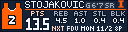
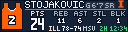
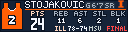
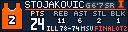

# Athlete Tracker (NCAAB)

Live/final cards show `OPP #N` when the opponent appears in ESPN's explicitly named AP Top 25 poll for the game's season (30-minute cache, no paid key). Missing/unranked AP results and other polls produce no badge. The badge uses measured header space without moving score/clock/overtime anchors; optional biography details yield before the player's name. This is the latest available poll, not a reconstructed historical game-day ranking.

Track one men's Division I college basketball player on two consecutive pages. Page 1 always shows the selected player's season averages. Page 2 shows live statistics during a game, then the most recent ESPN final after it ends.

Both pages use the same approved layout as Team Tracker (NCAAB), including the player's name, jersey number, position, height, class, team logo, and PTS/REB/AST/STL/BLK.

## Preview

These are illustrative layout examples, not current game results.

### Page 1 — Season averages

### Page 2 — Live game

### Page 2 — Final game

### Page 2 — Overtime final

## Settings

- **Team + Player:** Search one combined dropdown, then choose the player from that school's current roster. Every selection includes the jersey number; no team, player, or game ID is required.

- **Studio layout preview:** AUTO uses actual data. LIVE DEMO, NORMAL FINAL DEMO and OT FINAL DEMO use illustrative statistics for layout review.

The app uses ESPN's public basketball data and refreshes every 300 seconds. The dropdown contains 5,417 player entries across 365 schools from the October 18, 2026 roster refresh. Only rosters identified by ESPN as the 2026–27 season were used for replacement. Bethune-Cookman, Miami (OH), New Hampshire, Texas A&M-Corpus Christi and Western Illinois still returned the previous season, so their existing options were retained. ESPN's rosters may remain incomplete; this is not a claim that every current player is present. The bundled picker requires periodic updates rather than updating itself automatically. Existing users whose selected option changed may need to reselect their player. Athlete IDs distinguish similar names.

Michigan jerseys use official maize (#FFCB05); Campbell jerseys use official Campbell Orange (#EA7125). Other jersey, abbreviation-readability and layout rules are unchanged.

The refreshed design includes larger editable jerseys with white collars and centered numbers, school-colored backgrounds, 64 custom team marks, compact decimals, measured header spacing, and separate regulation/overtime final layouts. Long score rows retain full team abbreviations; PTS moves only when required for space. Missing statistics display `--` instead of invented zeroes. An alternate ESPN host is tried on API failure, but it is not an independent data source.

Validation passed for both pages. The October 18 update checks all 5,417 dropdown choices against the bundled player-ID map. The previous layout audit covered 41,752 foreground-text bounds cases across roster names and stress-test game states; that full bounds audit has not been repeated for the refreshed names. These checks and sampled previews cannot guarantee every future provider payload.
