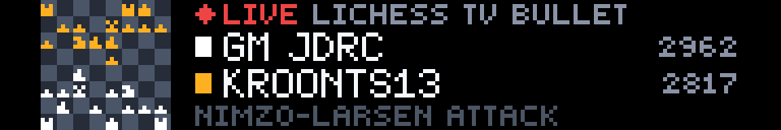
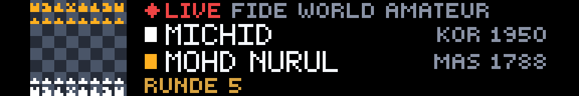
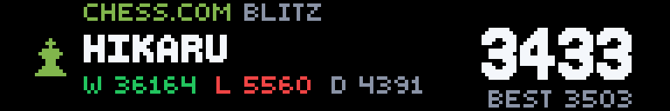
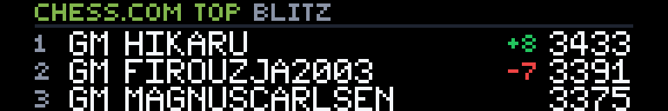
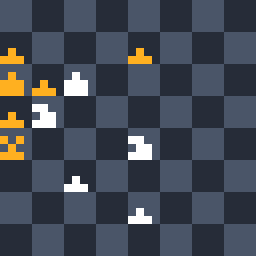

# Chess Live

**Created by Reyos** · Sports · 192×32 SCROLL · No API key needed

Chess on your Glance panel, drawn as a **real chess board**. A panel is 32 pixels tall and a board is 8 squares, so every square is 4 pixels and the whole board fits. Three pages, built around what chess fans actually follow: **elite chess live**, **your own Chess.com rating**, and **today's puzzle**.



> 💬 **Comments or suggestions?** Reach out to **Reyos** on Discord.

---

## Contents

- [At a glance](#at-a-glance)
- [Page 1: Live chess](#page-1-live-chess)
- [Page 2: Your rating](#page-2-your-rating)
- [Page 3: Daily puzzle](#page-3-daily-puzzle)
- [Reading the board](#reading-the-board)
- [Settings](#settings)
- [Why these three pages](#why-these-three-pages)
- [How it works](#how-it-works)
- [Screens for every situation](#screens-for-every-situation)
- [Limitations](#limitations)
- [For developers](#for-developers)

---

## At a glance

| Page | What it shows |
|---|---|
| **1 · live** | The featured board from an **elite tournament** while a round is on (Tata Steel, Candidates, Grand Chess Tour…). Otherwise, the **top game being played on Lichess right now**. |
| **2 · you** | **Your Chess.com rating**, your best ever and your win/loss/draw record. With no username set, the **Chess.com top 3**. |
| **3 · puzzle** | **Today's Chess.com daily puzzle** on the board, from the side to move. |

---

## Page 1: Live chess

### Elite events



When an **elite** over-the-board tournament has a round in progress, page 1 follows its featured board: the top board that's still playing. Lichess broadcasts every major event and ranks them by tier; the app only takes **tier 5**, the elite events.

- **The board:** the live position, with the **last move highlighted** in olive.
- **Header:** **● LIVE** and the tournament name.
- **Players:** surname, country code and rating.
- **Round:** shown in gold. When the game ends, the result shows instead: `1-0 WHITE WINS`, `0-1 BLACK WINS` or `1/2-1/2 DRAW`.

*(The image above uses a lower-tier event so it could be shown today. No elite round was in progress while this was written.)*

### Lichess TV


Between elite rounds, page 1 shows [Lichess TV](https://lichess.org/tv): the **highest-rated game being played on Lichess right now**, around the clock. So there's always a live game on the panel.

- **Players:** each with a white or gold chip for their side, their title (GM, IM…) when it fits, and their rating.
- **Opening:** the opening being played, e.g. `QUEEN'S PAWN GAME`.
- **Game over:** `FINAL` and the result, e.g. `BLACK WINS - CHECKMATE`.

---

## Page 2: Your rating



Type your **Chess.com username** in the settings and this page becomes yours:

- **Rating:** your current rating for the time control you chose, as the big number.
- **Best ever:** shown underneath, e.g. `BEST 3503`. When you're at your peak it reads **`NEW BEST`** in green.
- **Record:** your wins, losses and draws, in green, red and grey.

(Shown: Hikaru Nakamura's blitz page.)



**No username?** You get the **Chess.com top 3** for your time control instead, the names every fan knows. Each comes with their title, current rating, and today's movement (`+8` in green, `-7` in red).

---

## Page 3: Daily puzzle


**Chess.com's daily puzzle**, the same one millions of players solve every day:

- **The board:** the puzzle position. When it's **black to move**, the board flips to black's side, just like on Chess.com.
- **Title:** the puzzle's name, e.g. `SLOW MOTION SQUEEZE`, with today's date.
- **Side to move:** `WHITE TO MOVE` or `BLACK TO MOVE`, with a matching chip.

Find the move, then check it on Chess.com.

---

## Reading the board



- **Orientation:** white plays from the bottom, except on a black-to-move puzzle.
- **Squares:** a dark slate board keeps the panel near-black, which reads best on LEDs.
- **Pieces:** **white** for white and **gold** for black. Each piece is a 3×3 pixel shape with a gap around it, so neighbors never merge.
- **Last move:** the two squares are tinted olive (elite boards).

At 4 pixels a square, it's the **pattern of the position** you read from across the room (pawn chains, which side is attacking, where the kings are), just like glancing at a board in a café.

---

## Settings

| Setting | Options | What it does |
|---|---|---|
| **Chess.com username** | Your username, or **NONE** *(default)* | Shows your rating, best and record on page 2. Leave it as NONE for the Chess.com top 3. **If your username has an underscore, type a space instead** (`magnus_fan` → `magnus fan`); the app puts the underscore back. Glance can't pass underscores in settings. |
| **Time control** | **Blitz** *(default)* | 3–5 minute games: the most popular online speed |
| | **Rapid** | 10–15 minute games |
| | **Bullet** | 1–2 minute games |

---

## Why these three pages

They come from research into what chess fans actually put on their screens:

- **Your own rating.** Every popular chess widget and tracker shows it: Elo Widgets, sixtyfour, the Stream Deck "Chess Stats" plugin, the Home Assistant Chess.com integration. The chess app people shared for the Tidbyt LED display (the closest thing to Glance) was a personal Chess.com viewer.
- **Elite events.** The World Championship drew a chess-record 613,000 peak viewers, and the Freestyle Grand Slam 6.5 million live views. Fans follow the elite events and the names they know.
- **The daily puzzle.** It's one of Chess.com's most-used features, and Chess.com built its own widget around the daily streak.

---

## How it works

**Data:** the free, official public APIs of [Lichess](https://lichess.org/api) and [Chess.com](https://www.chess.com/news/view/published-data-api). No account or API key is needed.

**Refresh:** the panel refreshes every **5 minutes**. Elite games are classical or rapid, so that's a move or two between updates. The puzzle changes once a day, and your rating changes after each game.

**Requests per refresh:** at most two, cached between refreshes:

| Page | Requests | Cached |
|---|---|---|
| live | 1–2 to Lichess | 60–300 s |
| you | 1 to Chess.com (2 only if a username isn't found) | 5 min |
| top 3 | 1 to Chess.com | 1 hour |
| puzzle | 1 to Chess.com | 1 hour |

**Colors:**

| Color | Meaning |
|---|---|
| 🔴 Red | LIVE tag, losses, a rating drop |
| 🟢 Green | Wins, a rating rise, `NEW BEST`, a finished game's result, and Chess.com's own green on page 2 |
| 🟡 Gold | Black's pieces and side chip, the round, the daily puzzle |
| Olive squares | The last move played |

---

## Screens for every situation

The app never shows a blank or broken panel:

| Situation | What you see |
|---|---|
| Lichess can't be reached | `LICHESS OFFLINE` · `LIVE GAMES RETURN WHEN IT IS BACK`, on a starting board |
| Chess.com can't be reached | `CHESS.COM OFFLINE` with what returns when it's back (rating, leaders or puzzle) |
| Username doesn't exist | `USER NOT FOUND` · `CHECK THE USERNAME IN SETTINGS` |
| Account hides its stats | `NO PUBLIC STATS` · `THIS ACCOUNT HIDES ITS RATINGS` (Magnus Carlsen's account is one) |
| No games in that time control | `NO BLITZ GAMES YET` · `PLAY ONE ON CHESS.COM TO START` |

---

## Limitations

- **Snapshots:** the board updates every 5 minutes, so it shows snapshots of a game, not every move.
- **Featured board only:** elite events show one board, the top board still playing.
- **Piece shapes:** at 3×3 pixels, pieces show the shape of the position more than exact piece identities.
- **Chess.com only for ratings:** page 2 doesn't show Lichess ratings.

---

## For developers

| | |
|---|---|
| **Size** | 192×32 (SCROLL) |
| **Pages** | `live`, `you`, `puzzle` |
| **Refresh** | 300 seconds. The username is a free-text setting, which Glance only allows at 5 minutes or slower. |
| **Requests** | 1–2 per page |

**Endpoints used.** Every request sends `Accept: application/json` and an identifying `User-Agent`; Chess.com answers 403 to a generic Python one.
- **Lichess:**
  - `GET /api/broadcast/top`: active broadcasts with `tour.tier` and `round.ongoing`. Elite is `tier >= 5`.
  - `GET /api/broadcast/-/-/<roundId>`: each board's `fen`, `lastMove`, players (`name`, `title`, `fed`, `rating`) and `status` (`*`, `1-0`, `0-1`, `½-½`).
  - `GET /api/tv/channels`, then `GET /game/export/<id>?moves=false&opening=true&lastFen=true`.
- **Chess.com:**
  - `GET /pub/player/<username>/stats`: `chess_blitz` / `chess_rapid` / `chess_bullet` → `last.rating`, `best.rating`, `record.win/loss/draw`. A 404 is followed by `GET /pub/player/<username>` to tell "no such user" from "stats hidden".
  - `GET /pub/leaderboards`: `live_blitz` / `live_rapid` / `live_bullet`, with `rank`, `title`, `username`, `score` and `trend_score {direction, delta}`.
  - `GET /pub/puzzle`: `title`, `fen`, `publish_time`.

**Preview and check it locally:**

```powershell
gdn studio apps/chess-live
gdn render apps/chess-live --page 2 --input "username=hikaru" --input "timecontrol=BULLET"
gdn render apps/chess-live --page 3
gdn validate apps/chess-live
```

---

**Created by Reyos** · Comments or suggestions? Reach out to **Reyos** on Discord.

Built for the [Glance Developer Network](https://github.com/glance-led-dev/glance-dev-network).
