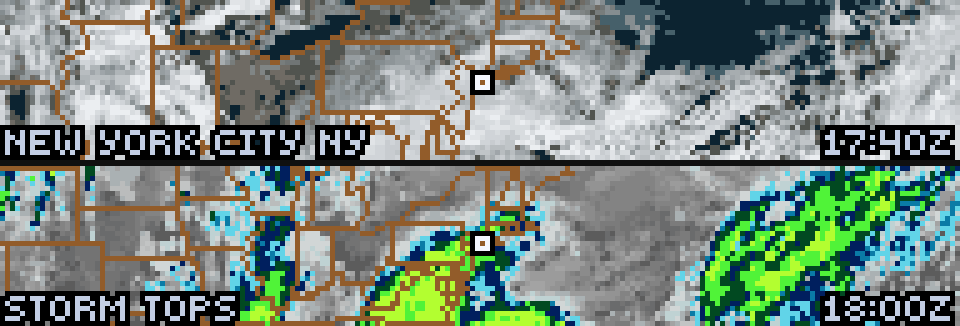
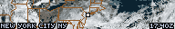
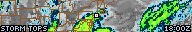

# Cloud Cover

**Created by Reyos** · Weather · 192×32 SCROLL · No API key needed

A live satellite view of your own patch of the Earth. GOES-19 sits over 75.2W and GOES-18 over 137.0W, both 35,786 km up, photographing the Americas every ten minutes. Two pages put your corner of that picture on the glass, full bleed: **the sky over your ZIP code**, and **the same sky as storm-top temperature**. State lines are drawn on, so you can tell whose weather you are looking at.



> 💬 **Comments or suggestions?** Reach out to **Reyos** on Discord.

---

## Contents

- [At a glance](#at-a-glance)
- [Page 1: Your sky](#page-1-your-sky)
- [Page 2: Storm tops](#page-2-storm-tops)
- [Reading the panel](#reading-the-panel)
- [Settings](#settings)
- [Why these two pages](#why-these-two-pages)
- [How it works](#how-it-works)
- [Screens for every situation](#screens-for-every-situation)
- [Limitations](#limitations)
- [Credits](#credits)
- [For developers](#for-developers)

---

## At a glance

| Page | What it shows |
|---|---|
| **1 · close** | **The sky over your ZIP code**, photographed in natural colour. Cloud by day, **city lights by night**. A small target marks your spot, and the frame's own time is in the corner |
| **2 · storm** | **The same sky as cloud-top temperature**, pulled back a little. Grey where the air is quiet, then green, yellow and red as the tops climb. It works as well at 3am as at noon |

---

## Page 1: Your sky



GOES **GeoColor**, which is as close to a photograph as satellite imagery gets.

- **The picture:** real cloud, where it actually is. Look out of the window, then look at the panel.
- **At night it changes entirely.** GeoColor switches to a night-time rendering, and **city lights come through** — the eastern seaboard, Chicago, the Front Range, all picked out in amber against the dark.
- **Your spot:** a small outlined target at the centre, on your ZIP code.
- **The caption:** your town and state on the left, and on the right **the time of the frame you are looking at**, in UTC (`17:40Z`) — not the clock's time. If the newest frame is more than three hours old, that is replaced by how old it is, in amber.

How much ground the page covers is yours to set: about **330, 550 or 890 km** from top to bottom. A 6:1 panel is six times as wide as it is tall, so even the middle setting spans most of the width of the lower 48.

---

## Page 2: Storm tops



The same sky through a different eye: **GOES band 13**, clean infrared, which measures how cold the cloud tops are.

- **Grey** is quiet air and low cloud.
- **Green, yellow and red** are tops climbing into the cold upper atmosphere — which is what a thunderstorm looks like from above. The redder it is, the taller the storm.
- **It is pulled back** a little wider than page 1, because weather worth knowing about is usually still a state away.
- **It reads temperature, not light**, so it is exactly as useful in the middle of the night as at midday.

---

## Reading the panel

| Colour | Meaning |
|---|---|
| ⚪ White / grey | Cloud on page 1; quiet air on page 2 |
| 🔵 Dark blue | Water, and clear night sky |
| 🟡 Amber specks | City lights, at night, on page 1 |
| 🟢 Green → 🟡 Yellow → 🔴 Red | Rising cloud tops on page 2: the colder and taller, the hotter the colour |
| 🟤 Copper | State and coast lines |
| ⬜ White target | Your ZIP code |

The copper is deliberately dark. The lines are there to tell you whose weather it is, not to be the thing you look at.

---

## Settings

| Setting | Options | What it does |
|---|---|---|
| **US ZIP code** | Any five digits · *default `10101`* | Where the view is centred. **GOES-East** is used east of about 112W and **GOES-West** beyond it, so Alaska and Hawaii work too |
| **How close** | **TIGHT**, **NORMAL** *(default)*, **WIDE** | How much ground page 1 covers, top to bottom: about 330, 550 or 890 km |
| **Mark your spot** | **ON** *(default)*, **OFF** | The target at your ZIP code. Turn it off for an uninterrupted picture |
| **State lines** | **ON** *(default)*, **OFF** | The state and coast outlines. Without them a strip of cloud is beautiful and completely unplaceable |

---

## Why these two pages

A satellite picture of your own sky is worth looking at on its own, but one view of it is not enough and three is too many.

- **The photograph is the hook.** Everyone understands cloud. And the night view, with the cities lit up, is the single best thing this app draws.
- **Infrared says what the photograph cannot.** A white blob in visible light might be fog or might be a supercell. Cloud-top temperature tells you which, and keeps telling you after dark.
- **There was a third page** showing the whole hemisphere as a disk. A 5,424-pixel disk resampled to 32 rows is a blur, and it has been dropped.

---

## How it works

**Data:** two free, public sources, with no account or API key:

| Used for | Source | Cached |
|---|---|---|
| Both frames | [NASA GIBS](https://nasa-gibs.github.io/gibs-api-docs/) (WMS), GeoColor and band 13 | 5 min |
| Which frame is newest | NASA GIBS time index | 5 min |
| ZIP code to latitude and longitude | [zippopotam.us](https://api.zippopotam.us) | 30 days |

**Refresh:** every **10 minutes**, matching the satellite's own cadence.

**The state lines are not fetched.** They are carried inside the app, from the US Census cartographic boundary file.

**Which satellite:** GOES-East for longitudes east of about 112W, GOES-West beyond it. The app picks for you from your ZIP code.

---

## Screens for every situation

| Situation | What you see |
|---|---|
| The ZIP is not five digits | `NO LOCATION` · `CHECK THE ZIP CODE` |
| The lookup does not know that ZIP | `NO LOCATION` · `NO SUCH US ZIP CODE` |
| The ZIP service is unreachable | `NO LOCATION` · `ZIP LOOKUP DID NOT ANSWER` |
| The frame index is unreachable | `NO FRAME INDEX` · `GIBS DID NOT ANSWER` |
| Three frames in a row come back empty | `NO PICTURE` · `THE GOES-EAST FRAME DID NOT ARRIVE` |
| The newest frame is over three hours old | The time is replaced by its age, in amber: `4H OLD` |

**There is no demo mode.** A panel whose whole purpose is to show you the real sky has no business inventing one.

---

## Limitations

- **It is as current as NASA is.** The lag is whatever GIBS is running, and that varies — measured at twenty minutes one morning and two hours forty the next. The panel always prints the time of the frame you are actually looking at, so it is never in doubt.
- **One pixel is a long way.** At the middle zoom a pixel is about 17 km, so an hour of a weather system's travel is two or three pixels.
- **US ZIP codes only.** The location lookup is American.
- **State lines, not county lines.** At 192 pixels for most of a continent, counties would be a smear.
- **No radar, no forecast.** This is what the satellite sees, not what anyone thinks will happen next.

---

## Credits

- **Imagery:** [NASA GIBS / EOSDIS](https://nasa-gibs.github.io/gibs-api-docs/), serving **NOAA GOES-19 and GOES-18** ABI data.
- **State and coast outlines:** the **US Census Bureau** cartographic boundary files.
- **ZIP code lookup:** [zippopotam.us](https://api.zippopotam.us).
- **Image resizing:** [images.weserv.nl](https://images.weserv.nl).
- **The trick that makes photographs possible on a panel at all** is **cfdmb's**, from `rain-watch`.

---

## For developers

| | |
|---|---|
| **Size** | 192×32 (SCROLL) |
| **Pages** | `close`, `storm` |
| **Refresh** | 600 seconds |
| **Requests** | 2 per page at most: the frame index, then the frame |
| **Scene** | 0.75 MiB of the 1 MiB budget |

**Getting a photograph onto a panel.** `http.get` carries text, not bytes, and `c.image()` only reads files shipped inside the app — so a picture from the internet looks impossible. It is not. `images.weserv.nl` fetches any public image, resizes it to exactly 192×32 and re-encodes it as a PNG whose deflate blocks are **stored** (`l=0`), handed back as base64 (`encoding=base64`). With nothing to inflate, the decoder is about forty lines instead of a zlib implementation. The technique is cfdmb's, from `rain-watch`.

**The quantiser.** A page may emit at most 4096 draw ops and no bitmap may hold more than 4096 cells, so the frame is laid down in three 64-wide chunks. Buckets are fixed arithmetic — 32 steps of grey for anything near-neutral, 48 coarse chroma cells for the rest — while each bucket's *colour* is the mean of the pixels that landed in it. Fixed buckets, adaptive palette, one pass, no nearest-colour search. Each page then keeps only its **20 most populous** buckets and folds the rest into the nearest survivor: every colour costs one bitmap per chunk, and the two pages share a 1 MiB budget.

**The state lines** come from the US Census file, snapped to an eighth of a degree, de-duplicated so a shared border is not drawn twice, chained between junctions, and simplified per arc — borders at 0.10°, the coast at 0.45°, since the coast is far wigglier and carries less per point. That packs to a 3.3 KB string and costs 140 line ops on page 1.

**They are scored, not eyeballed.** `_tools/border-critic/` holds a harness that renders the table over four frames — a coastal city, an interior one, a tight zoom and a wide one — and compares it against the same map drawn straight from the Census file, checking for dangling ends, confetti, staircase, invented line and missing line. Thresholds come from the reference rather than from taste. Three separate faults were found that way, every one of which looked like a styling problem on the panel and was obvious in the score.

**Preview and check it locally:**

```powershell
gdn studio apps/cloud-cover
gdn render apps/cloud-cover --page 1 --input "zip=80202" --input "zoom=TIGHT"
gdn render apps/cloud-cover --page 2 --input "zip=64108"
gdn validate apps/cloud-cover
```

To see the failure screens, set `GDN_HTTP_OFFLINE=1` first.

---

**Created by Reyos** · Comments or suggestions? Reach out to **Reyos** on Discord.

Built for the [Glance Developer Network](https://github.com/glance-led-dev/glance-dev-network).
