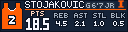
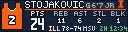
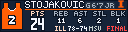
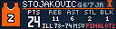

# Team Boxscore Tracker (NCAA)

Ranked opponents: live/final cards show a measured `OPP #N` header badge from ESPN's explicitly named AP Top 25 poll for the game's season. The poll response is cached for 30 minutes and uses no paid key. Generic curated ranks and Coaches Poll ranks are not used. Unranked/missing AP results show no badge. Optional biography space yields to the badge and player name; score, clock and overtime anchors are unchanged. The latest available poll is used, not a reconstructed historical game-day poll.

Seven 128×32 player cards for a selected men's Division I basketball team. During games, the rotation includes the five starters and two highest-scoring bench players, sorted by points. Between games it shows season averages.

## Display

School-colored backgrounds, editable jersey artwork with centered numbers and white collars, team logos, and a prominent points column. Player surnames take priority over optional position, height and class details; initials distinguish duplicate surnames.

Live scores sit beneath REB/AST/STL/BLK. Regulation finals and overtime finals have separate spacing. Status labels include HALFTIME, OT, OT2 and FINAL OT2. Longer score rows remain on one line; the points column adjusts only when needed to avoid overlap.

## Illustrative previews

These are layout examples with demonstration statistics, not current game results.

## Settings

- **Team:** Select from 365 teams, cross-checked against the NCAA's 2026–27 men's Division I basketball directory.
- **Preview:** Keep AUTO for real data. LIVE DEMO, NORMAL FINAL DEMO and OT FINAL DEMO are explicitly simulated layout previews.
- **Event:** Leave AUTO for automatic game selection; an ESPN event ID can select a specific game.

The existing five-minute refresh interval is unchanged. ESPN supplies rosters, season statistics and game data. An alternate ESPN API host is tried when the primary request fails; this is not an independent data provider. Missing statistics show `--`, and unavailable data produces an explicit status rather than invented numbers. A roster with fewer than seven players shows LINEUP NOT POSTED on unfilled cards. During the release audit, LSU and Oregon State each returned six players.

## Release checks

All 365 dropdown entries resolve to team metadata and have logo assets. Added 64 custom team marks from the bracketology collection. Automated foreground-text bounds checks covered 20,440 synthetic stress cases and 41,752 actual-roster-name cases, including triple-digit scores/statistics, halftime and overtime. These checks supplement sampled rendered previews; they cannot guarantee every future provider payload. No credentials, cached rosters or local audit artifacts are included.
