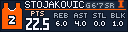
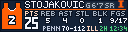
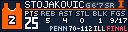
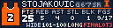

# Team Boxscore Tracker (NCAA)

Eight 128×32 player cards for a selected men's Division I basketball team. During games, the rotation includes the five starters and three highest-scoring bench players, sorted by points. Between games it shows the eight highest season averages.

## Display

School-colored backgrounds, editable jerseys with centered numbers and white collars, team logos, and a prominent points column. Position, height and class use the larger 4x5 font. A first initial is added only if it fits in the existing font without reducing the gaps or removing bio details. Initials still distinguish duplicate surnames.

Game scores sit below the supporting stats. Status labels include 1H, 2H, HT, OT, OT2 and subsequent overtime numbers. Regulation finals show FINAL; overtime finals show FINAL OT, FINAL OT2, etc., with a visible separator. The halftime scoreboard sits four pixels before HT. Opponent rankings are not displayed or fetched.

Each stat is centered beneath its label. LIVE and FINAL add FGS on the right, with made/attempted field goals (for example, `9/17`) from the existing box score. Zero attempts show `0/0`; unavailable values show `--`. Season-average cards retain their five stat columns and decimal formatting.

Long scoreboards stay on one line without shortening team codes. The points column stays in place; when a long footer needs the space below it, the points value uses a compact font above the footer.

## Illustrative previews

These are layout replays using archived or simulated game states, not current game results.

The generated eight-page catalog poster is [preview/preview.png](preview/preview.png).

## Settings

- **Team:** Select from the app's 365-school directory. No API key is needed.

The five-minute refresh interval is unchanged. Game discovery uses the selected team's ESPN schedule, not the national scoreboard. Schedule and summary reads are cached for five minutes; roster and season-average reads are cached for six hours. Season averages use ESPN's structured full-season team feed first, with the ESPN team stats webpage as a fallback. Both are ESPN sources; this does not add hosting or protect against a complete ESPN outage.

Roster members without posted season-average rows show `--`. A roster with fewer than eight eligible players shows LINEUP NOT POSTED on unfilled cards. Source failures and unposted boxscores have explicit fallback screens. Automatic live coverage depends on ESPN listing the game and its boxscore; this app does not add a separate exhibition-stat feed.

Game selection is automatic. Saved testing/demo overrides from earlier versions are ignored. There are no scenario/demo or manual game-ID settings. Automated-test fixtures are kept outside the release-app folders and are not served by the Studio previews.

## Release checks

Local validation checks all 365 selections and logo assets, all eight page entrypoints, player selection, centered stat values, decimal preservation, long score lines, larger biography text, exceptional surnames, source failures and the absence of public test controls. Layout fixtures and mocked ESPN responses are test evidence, not claims about actual games. These checks cannot guarantee every future provider payload or upstream roster completeness.

After Glance publishes an approved update, verify the actual phone setup form contains only Team, preserves the selected school, and rotates eight pages. No credentials or local review harness files belong in this public app folder.

## Reliability update

Game discovery uses the selected school's ESPN schedule instead of the oversized
national NCAA scoreboard. Today's summary is checked even when a cached schedule
still says pregame. Live games, halftime, overtime, finals, overnight transitions,
and conflicting or unavailable feeds have explicit handling. A failed feed does
not silently become season averages. Malformed or duplicate box-score rows are
rejected; missing individual statistics remain unknown (`--`), not invented zeroes.

Missing position and height are filled independently from the exact roster athlete
ID. Class and jersey use roster fallback when absent from the game. Valid game
biography remains authoritative; details absent from both sources are not guessed.

The eight team pages retain final statistics until 24 elapsed hours after
tipoff, then return to season averages. A newer live game takes priority. A
confirmed pregame does not erase a still-retained final. This is elapsed UTC time,
so daylight-saving changes cannot shorten or lengthen the window. Game selection
remains five starters plus three bench scoring leaders, displayed in scoring
order; averages use the top eight season scorers. With fewer than eight eligible
game participants, an unfilled page says LINEUP NOT POSTED rather than substituting
a preview or averages.

The structured averages feed is validated for the selected team, season and
complete stat columns. The HTML fallback validates its embedded stat array
before decoding. A verified recent team box score can recover the identity
and jersey of a player missing from the roster, without per-player requests.
Missing individual averages display `--`, not zero.

Refresh remains 300 seconds. App identity, artwork and public author JSW41
are unchanged. The release replay covers all eight cards, source failures,
roster omissions, live shooting, regulation and overtime finals, and the
eight-uncached-request ceiling. These are local checks, not production certification.
