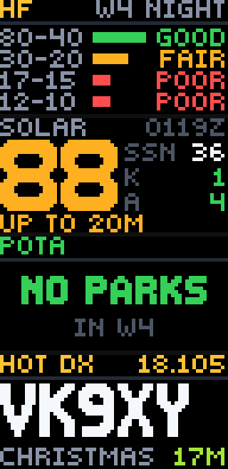

# Ham Shack

A ham radio shack display on a **64x32** panel: how the HF bands are right
now, the solar numbers behind them, who is activating a park, and the station
drawing the biggest pileup on the cluster.



Ships as a pair with **`ham-shack`** (192x32, SCROLL). Same feeds, same
settings, different panel. This one is **`ham-shack-led`** because
`ham-shack` is already published and renaming an app id would break every
panel that has it installed — the same reason `custom-sports-schedule` kept
its id when its 64-wide twin arrived.

No key, no account. All three feeds are public.

## The four pages

**bands** — the four HF band groups with `GOOD` / `FAIR` / `POOR`, each with
a bar the length of its verdict so the page reads from across the room.

The 192-wide version shows a day **and** a night column. 64 pixels will not
hold both, so this one shows the half that applies: the header says
`W4 NIGHT`, and at six in the morning it will say `W4 DAY`. Daytime is
reckoned from the middle of the call area you pick. `WORLDWIDE` has no local
noon, so it reads UTC and labels itself `WW`.

**solar** — the solar flux index as the hero, in the colour of what it is
worth, with SSN, K and A beside it and the highest band that flux supports
underneath.

**pota** — the newest Parks on the Air activator in your area: call sign in
the biggest face it fits, the frequency, a mode chip and the state, with the
number on the air in the header.

**dx** — the station spotted most often on the cluster from outside your
continent, with where to find it in the header and its country and band
below.

## Settings

| Setting | What it does |
|---|---|
| **Your area** | Which POTA activators count, and whether the bands page reads day or night. DX from your own continent is left off the DX page — working your neighbours is not DX. |
| **Mode** | All modes, or only CW, phone (SSB, FM, AM) or digital (FT8, FT4, RTTY…). Filters both POTA and DX. |

The area shows on the bands header (`W4 NIGHT`) and the mode on the POTA
scope line (`W1 CW`), so you can always see which filter is in force.

## How high will the flux carry you

The line under the flux number is not invented. It is N0NBH's own
[band-openings table](https://www.hamqsl.com/solar2.html), the one printed
and taped up in a lot of shacks:

| SFI | Shown | Roughly |
|---|---|---|
| 200+ | `ALL BANDS 6M` | reliable all the way up through 6m |
| 150–199 | `10M PLUS 6M` | excellent through 10m, 6m openings |
| 120–149 | `UP TO 10M` | fair to good through 10m |
| 90–119 | `UP TO 15M` | fair through 15m |
| 70–89 | `UP TO 20M` | poor to fair through 20m |
| under 70 | `40M AND DOWN` | above 40m unusable |

K and A are coloured by the same convention every banner uses: K 0–2 green,
3–4 amber, 5 and up red; A under 15 green, under 30 amber, above that red.

## Data sources

| Source | Used for | Cached |
|---|---|---|
| `hamqsl.com/solarxml.php` | N0NBH solar-terrestrial data — band conditions, SFI, SSN, K, A | 1800s |
| `api.pota.app/spot/activator` | live POTA activator spots | 60s |
| `hamqth.com/dxc_csv.php` | the last 200 DX cluster spots | 60s |

One call per page render, two feeds at most on any single page. `refresh` is
120s, which tracks the two live feeds; the solar XML only moves every half
hour, so it is cached for that long.

A spot is dropped when the activator's comment says `QRT` — they have signed
off and are no longer on the air. Only the newest spot per activator counts,
so one operator working a pileup is one entry, not forty. On the DX page a
station that spotted itself is not a pileup and is skipped.

## When something is missing

| Screen | Meaning |
|---|---|
| `NO SOLAR` / `HAMQSL DOWN` | the solar XML did not answer |
| `POTA DOWN` / `BACK SOON` | the POTA API did not answer |
| `NO CLUSTER` / `BACK SOON` | the cluster feed did not answer |
| `NO PARKS` / `IN W1 CW` | reached POTA, nobody is on in that area and mode |
| `NO HOT DX` / `ALL QUIET` | the cluster answered, nothing outside your continent |

The last two are green and grey, not amber: an empty band is an answer, not
a fault. There is no demo mode — a propagation panel inventing propagation
is worse than one that says it has nothing.

## Running it

From the repository root:

```bash
gdn studio apps/ham-shack-led
```

Rendering one page:

```bash
gdn render apps/ham-shack-led --page 2 --input "area=W4 SOUTHEAST"
```

To see the no-data screens, set `GDN_HTTP_OFFLINE=1` first — every
`http.get` then fails, which is exactly what the publish-time validator does.

If `gdn` is not on `PATH`, use `python -m gdn` in its place.

## Notes on the layout

64x32 has no neighbouring app to pad against, so column 0 and column 63 are
both in use. Every string is measured before it is drawn: a `4x5` glyph
advances **5** pixels, not 4, because the font carries a one-pixel gap, and
the renderer clips at the border in silence. `HOT DX` beside a spot count
wants 71 pixels of a 64-pixel panel — which is why the DX header carries the
frequency instead, and why the spot tally is the one thing from the wide
version that did not make it over.

The solar page is the only one without the hairline under its header: five
rows of header, twenty of hero and five of verdict come to exactly 32, and
the flux is worth the big face.

Built for the [GLANCE Developer Network](https://github.com/glance-led-dev/glance-dev-network).
