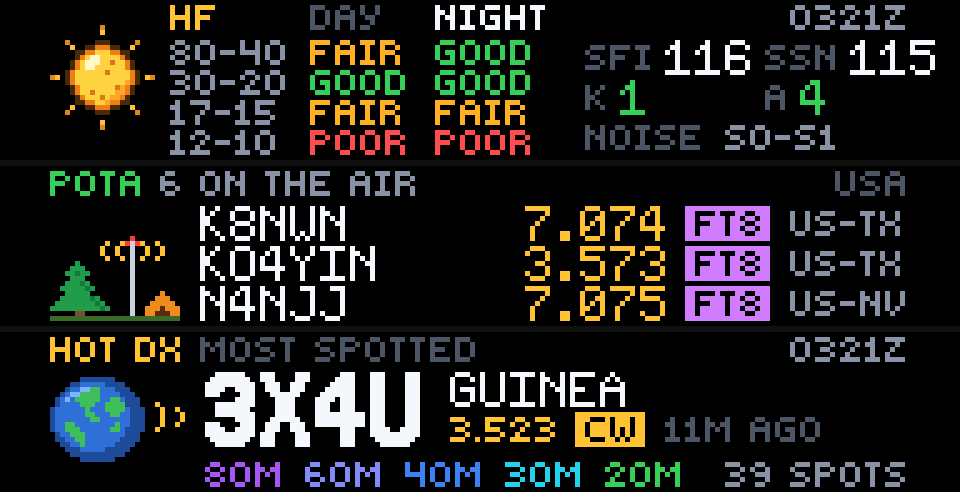
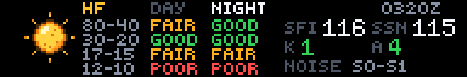
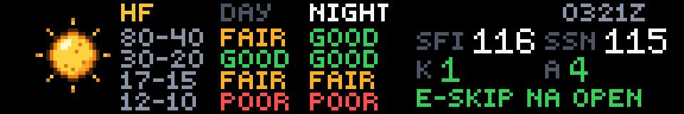
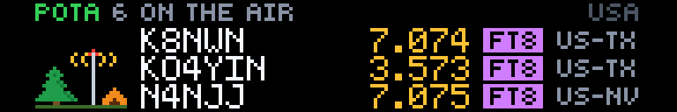
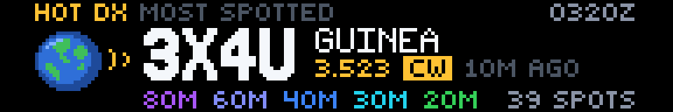

# Ham Shack

**Created by Reyos** · Science · 192×32 SCROLL · No API key needed

A shack display for amateur radio operators. Three pages cover what hams keep an eye on: **HF band conditions** with the solar numbers behind them, live **Parks on the Air** activators in your area, and **the hottest DX on the cluster** right now.



> 💬 **Comments or suggestions?** Reach out to **Reyos** on Discord.

---

## Contents

- [At a glance](#at-a-glance)
- [Page 1: HF band conditions](#page-1-hf-band-conditions)
- [Page 2: Parks on the Air](#page-2-parks-on-the-air)
- [Page 3: Hot DX](#page-3-hot-dx)
- [Reading the panel](#reading-the-panel)
- [Settings](#settings)
- [Why these three pages](#why-these-three-pages)
- [How it works](#how-it-works)
- [Screens for every situation](#screens-for-every-situation)
- [Limitations](#limitations)
- [Credits](#credits)
- [For developers](#for-developers)

---

## At a glance

| Page | What it shows |
|---|---|
| **1 · bands** | **HF band conditions** for day and night (80m to 10m), with the solar flux (SFI), sunspot number (SSN), K and A indexes, the noise level, and any VHF opening |
| **2 · pota** | The **three newest POTA activators** in your area and mode: call, frequency, mode and state, plus how many parks are on the air |
| **3 · dx** | **The most-spotted DX station** on the cluster right now: call, country, frequency, mode, the bands it's been heard on, and its spot count |

---

## Page 1: HF band conditions



N0NBH's band conditions, the same table hams have on QRZ pages and shack screens everywhere:

- **The table:** each band pair (**80-40, 30-20, 17-15, 12-10**) for **day** and **night**, in **green GOOD**, **amber FAIR** or **red POOR**.
- **Time of day:** the column for your current time is lit (here **NIGHT**), based on your area setting.
- **The numbers:**
  - **SFI:** solar flux. Higher means better high bands.
  - **SSN:** sunspot number.
  - **K** and **A** indexes, in green when quiet, amber when unsettled and red during a storm.
- **The clock:** **UTC** in the corner (`0305Z`), because hams log in UTC.
- **The bottom line:** the band **noise** level (`S0-S1`). When there's a **VHF opening** on your side of the world (6m E-skip, aurora), that takes its place in green:



### The sun counts its sunspots


The sun beside the table is drawn from the real data. It carries **one sunspot for every 25 in the sunspot number**, up to six, so a glance tells you how active the sun is. More spots usually means better conditions on 15, 12 and 10 meters.

---

## Page 2: Parks on the Air



[Parks on the Air](https://pota.app) is one of the most popular activities in ham radio: operators set up portable stations in parks, and hunters work them from home. This page shows **who's on the air right now**:

- **Header:** **POTA**, how many activators are on the air in your area (`7 ON THE AIR`), and your area and mode filter.
- **The three newest activators:** each row shows the **callsign**, the **frequency** in MHz (gold), a **mode badge** and the **state or province** of the park.
- **Mode badges:** **gold CW**, **blue SSB / phone** and **purple FT8 / digital**.

Activators who've signed off (**QRT** in their spot) are left out, so everyone listed is still on the air. Long portable calls drop their suffix instead of being cut off (`KC2QVD/VA2` → `KC2QVD`).

The campsite shows a pine, a tent, and a portable vertical antenna on the air.

---

## Page 3: Hot DX



**The most-spotted DX station** on the DX cluster over the last couple of hours. This is how a DXpedition announces itself: everyone spots it. In the image above it's **3X4U in Guinea**, spotted 39 times on five bands.

- **The call sign**, big, and its **country**.
- **Where it was last heard:** the frequency, a mode badge (**CW**, **SSB**, **FT8**…) and how long ago.
- **Bands:** every band it's been spotted on, each in its own colour (**80M** purple, **40M** blue, **30M** cyan, **20M** green…).
- **Spot count:** how many spots it has drawn.

**It's real DX:** stations on your own continent are left out, so a US station sees what's rare from North America, not the ham down the road. Worldwide leaves everything in. Self-spots (a station spotting itself) don't count toward the ranking.

The call is shown in the biggest face that fits, including portable calls like `LX/PA1L`.

---

## Reading the panel

| Colour | Meaning |
|---|---|
| 🟢 Green | GOOD conditions, a quiet K or A index, a VHF opening, POTA |
| 🟠 Amber | FAIR conditions, an unsettled K index |
| 🔴 Red | POOR conditions, a geomagnetic storm |
| 🟡 Gold | Frequencies, the CW badge, hot DX |
| 🔵 Blue | SSB / phone badge |
| 🟣 Purple | FT8 / digital badge |

**Band colours** on the DX page: **160M** brown, **80M** purple, **60M** indigo, **40M** blue, **30M** cyan, **20M** green, **17M** lime, **15M** yellow, **12M** orange, **10M** red, **6M** pink.

---

## Settings

| Setting | Options | What it does |
|---|---|---|
| **Your area** | **USA** *(default)*, **Canada**, **Worldwide**, or a **US call area**: W1 New England, W2 NY NJ, W3 Mid Atlantic, W4 Southeast, W5 South Central, W6 California, W7 Northwest, W8 MI OH WV, W9 IL IN WI, W0 Plains | Which POTA activators page 2 shows. It also sets which continent counts as "home" for hot DX, and whether page 1 lights the day or night column. |
| **Mode** | **All modes** *(default)*, **CW**, **Phone**, **Digital** | Shows POTA and DX spots for every mode or just one. Phone is SSB, FM and AM; digital is FT8, FT4, RTTY, PSK and the rest. |

The US call areas group the states the way the FCC does, e.g. **W4** is AL, FL, GA, KY, NC, SC, TN and VA.

---

## Why these three pages

They come from looking at what hams actually put on their shack displays:

- **HamClock** was the classic always-on shack display for years. Its creator, Elwood Downey (WB0OEW), became a silent key in January 2026, and its original backend was due to shut down in June 2026. Hams have been looking for replacements since.
- **The DX cluster** is the core feed of every shack dashboard. OpenHamClock calls the DX Spider network the primary data feed for most operators.
- **Band conditions and space weather** come next on every dashboard. N0NBH's band-conditions table is a fixture on ham websites and QRZ pages.
- **POTA** is standard on modern dashboards and one of the fastest-growing activities in the hobby. Georgia State Parks on the Air alone logged 17,000 QSOs and 4,800 hunters in 2025.

---

## How it works

**Data:** three free, public sources, with no account or API key:

| Page | Source | Cached |
|---|---|---|
| bands | [N0NBH solar-terrestrial data](https://www.hamqsl.com/solar.html) (XML) | 30 min (it updates hourly) |
| pota | [POTA activator spots](https://pota.app) (JSON) | 1 min |
| dx | [HamQTH DX cluster](https://www.hamqth.com/) (the last 200 spots, CSV) | 1 min |

**Refresh:** every **2 minutes**. One request per page.

**Modes on the DX cluster:** cluster spots don't carry a mode, so the app works it out. It uses the spot comment when it says (`FT8`, `CW`, `SSB`…); otherwise the frequency, from the FT8/FT4 watering holes and each band's CW segment.

---

## Screens for every situation

| Situation | What you see |
|---|---|
| Solar data unreachable | `SOLAR DATA OFFLINE` · `BAND CONDITIONS RETURN SOON` |
| POTA unreachable | `POTA OFFLINE` · `PARK SPOTS RETURN SOON` |
| No activators in your area and mode | `NO PARKS ON AIR` · `NONE IN W4 CW RIGHT NOW` |
| DX cluster unreachable | `DX CLUSTER OFFLINE` · `SPOTS RETURN SOON` |
| No DX in your mode | `NO DX SPOTTED` · `THE CLUSTER IS QUIET` |

---

## Limitations

- **No callsign or grid:** there are no personal settings, so the app shows conditions and spots for everyone, not your own signal.
- **Band conditions are general:** N0NBH's table is a worldwide estimate, not a path prediction from your grid square.
- **Approximate day and night:** the day/night column uses your area's time zone (06–18 local), not your exact sunrise.
- **Inferred modes:** cluster modes come from the band plan when a spot doesn't say, so an odd frequency can be misread.

---

## Credits

- **Solar-terrestrial data and band conditions:** courtesy of **Paul Herrman, N0NBH** ([hamqsl.com](https://www.hamqsl.com/solar.html)). His data in turn comes from NOAA SWPC, Space Weather Canada and the Lowell GIRO Data Center.
- **POTA spots:** [Parks on the Air](https://pota.app).
- **DX cluster:** [HamQTH](https://www.hamqth.com/).

73!

---

## For developers

| | |
|---|---|
| **Size** | 192×32 (SCROLL) |
| **Pages** | `bands`, `pota`, `dx` |
| **Refresh** | 120 seconds. Both settings are pick-lists (13 × 4 = 52 combinations), which Glance allows at 2 minutes with live data. |
| **Requests** | 1 per page |

**Endpoints used.** Every request sends an identifying `User-Agent`.
- `GET https://www.hamqsl.com/solarxml.php`: `<solarflux>`, `<sunspots>`, `<aindex>`, `<kindex>`, `<signalnoise>`, `<band name="80m-40m" time="day">Fair</band>` and `<phenomenon name="E-Skip" location="north_america">Band Closed</phenomenon>`. Read with plain string matching.
- `GET https://api.pota.app/spot/activator`: a list of `activator`, `frequency` (kHz), `mode`, `reference`, `locationDesc` (`US-TX`), `spotTime` (UTC).
- `GET https://www.hamqth.com/dxc_csv.php?limit=200`: `^`-separated `spotter^freq^dx^comment^HHMM YYYY-MM-DD^lotw^eqsl^continent^band^country^dxcc`.

**Preview and check it locally:**

```powershell
gdn studio apps/ham-shack
gdn render apps/ham-shack --page 2 --input "area=W4 SOUTHEAST" --input "mode=CW"
gdn render apps/ham-shack --page 3 --input "area=WORLDWIDE"
gdn validate apps/ham-shack
```

---

**Created by Reyos** · Comments or suggestions? Reach out to **Reyos** on Discord.

Built for the [Glance Developer Network](https://github.com/glance-led-dev/glance-dev-network).
