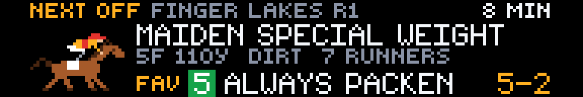
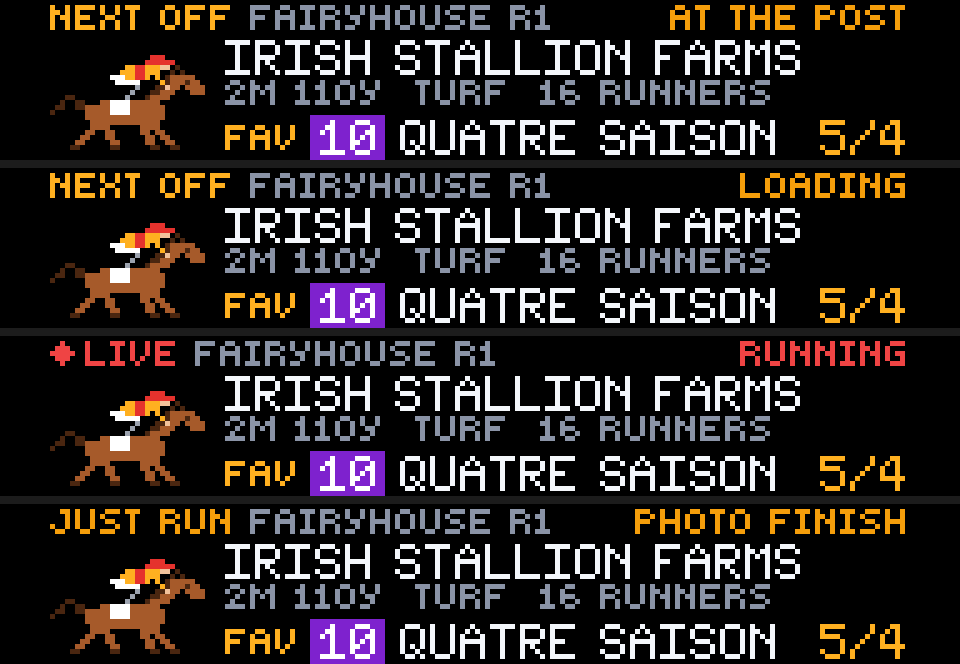
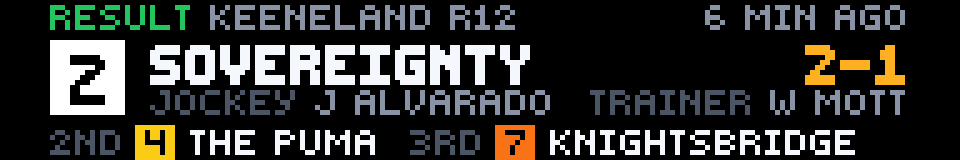
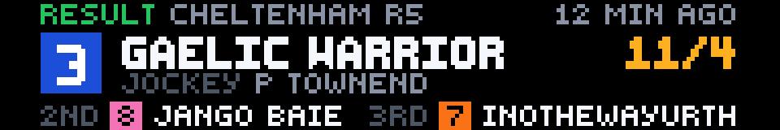
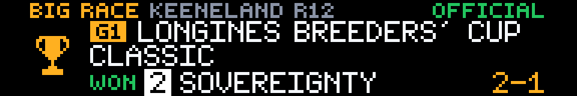
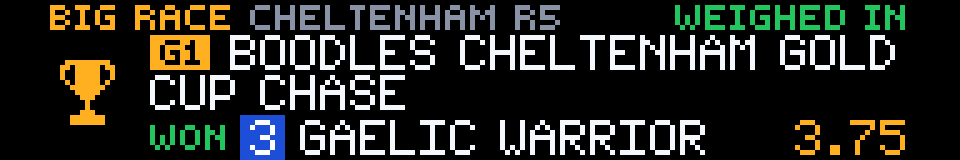
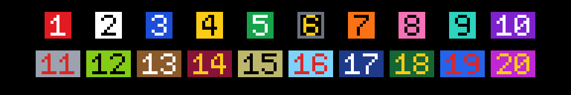

# Horse Racing Live

**Created by Reyos** · Sports · 192×32 SCROLL · No API key needed

Horse racing on your Glance panel, the way fans follow a race day: **the next race to the off**, **the latest official result**, and **the day's big race**. It covers every US track plus Britain, Ireland and the rest of the world, with live race stages, the favourite's odds, jockeys, trainers and saddle-cloth colours.


> 💬 **Comments or suggestions?** Reach out to **Reyos** on Discord.

---

## Contents

- [At a glance](#at-a-glance)
- [Page 1: Next off](#page-1-next-off)
- [Page 2: Latest result](#page-2-latest-result)
- [Page 3: Big race](#page-3-big-race)
- [Reading the panel](#reading-the-panel)
- [Settings](#settings)
- [Why these three pages](#why-these-three-pages)
- [How it works](#how-it-works)
- [Screens for every situation](#screens-for-every-situation)
- [Limitations](#limitations)
- [For developers](#for-developers)

---

## At a glance

| Page | What it shows |
|---|---|
| **1 · next** | The **next race off** in your region, counted down to post time and followed through the gate: at the post, loading, **LIVE**, photo finish. Shows the field size, purse and **the favourite with its odds**. |
| **2 · result** | The **latest official result**: the winner's saddle cloth and name, the winning odds, the jockey and trainer, and who ran 2nd and 3rd. |
| **3 · feature** | **Today's biggest race**, Grade 1s first (Kentucky Derby, Breeders' Cup, Cheltenham Gold Cup, Royal Ascot…). Shows the countdown, favourite and tip, then **the winner**. |

---

## Page 1: Next off



The next race to go in your region, from any track:

- **Header:** `NEXT OFF`, the track and race number (`FINGER LAKES R1`), and the **countdown** to post time (`8 MIN`, `1H 05M`).
- **Race:** the race name (`MAIDEN SPECIAL WEIGHT`, `BREEDERS' CUP CLASSIC`), with the grade when it has one (`G1`), the distance, the surface, how many are running and the purse.
- **Favourite:** **`FAV`**, its saddle cloth and name, and its current odds (`5-2`).

### Race day, live



As the race gets close, the countdown gives way to **what's happening at the track**, as the track reports it:

| Stage | What you see |
|---|---|
| Horses walking to the start | `GOING TO POST` · `AT THE POST` |
| Loading into the gate / stalls | `LOADING` · `UNDER ORDERS` |
| **They're off** | **● LIVE** in red · `RUNNING` |
| Finish too close to call | `JUST RUN` · `PHOTO FINISH` |
| Hold-ups | `DELAYED` · `FALSE START` |

Once the result is official, it moves to page 2 and page 1 moves on to the next race.

---

## Page 2: Latest result



The most recent **official** result in your region:

- **Winner:** a big saddle cloth with the winner's number, the horse's name, and the **winning odds** in gold.
- **Connections:** the jockey and, when it fits, the trainer.
- **Placings:** **2nd** and **3rd** with their saddle cloths.
- **Header:** the track, race number and how long ago it went off (`9 MIN AGO`).

Only official results appear here: "official" at US tracks, "weighed in" in Britain and Ireland. An amended result says `AMENDED RESULT`.



*(Shown: the 2026 Breeders' Cup Classic, won by Sovereignty for Junior Alvarado and Bill Mott, and the Cheltenham Gold Cup.)*

---

## Page 3: Big race



**The day's biggest race in your region**, with a gold trophy:

- **Header:** **`BIG RACE`**, the track and race number, and the countdown (`IN 2H 20M`) or the race's stage.
- **Race:** a gold **grade badge** (`G1`, `G2`, `G3`, `L` for Listed) and the full race name over two lines.
- **Before the race:** the **favourite** and its odds, plus **Sporting Life's tip** when the expert verdict has one.
- **After the race:** **`WON`** with the winner, its saddle cloth and odds.

**Big days, race by race.** On a day with several Grade 1s (Breeders' Cup, Cheltenham, Royal Ascot, Kentucky Derby day), the page walks through them. Each winner shows for 30 minutes after its race, then the next big race takes over. After the last one, its result holds the evening.



**Quiet days.** When no graded or stakes race is on, the page shows the day's **top race** instead, ranked by stakes, allowance and maiden level in the US and by race class in Britain and Ireland. The header reads `TOP RACE` rather than `BIG RACE`.

---

## Reading the panel

### Saddle cloths



Every horse wears its number on the **standard North American saddle-cloth colour**, the same colours on every US tote board and TV graphic: **1** red, **2** white, **3** blue, **4** yellow, **5** green, **6** black, **7** orange, **8** pink, **9** turquoise, **10** purple, and so on to **20**. The app uses them for every race, so a horse is easy to pick out at a glance. (British and Irish saddle cloths have no colour code, so the app applies the US colours to every race; the numbers are the same.)

### Colours

| Colour | Meaning |
|---|---|
| 🟡 Gold | `NEXT OFF`, `FAV`, odds, `BIG RACE`, the grade badge |
| 🔴 Red | **● LIVE**: the race is running |
| 🟠 Amber | Stages at the track (`AT THE POST`, `LOADING`, `PHOTO FINISH`) |
| 🟢 Green | `RESULT`, `WON`, official |
| Grey | Race facts, jockeys and trainers |

### Odds

Odds are shown the way the track's fans read them. **US races** show `5-2` and `EVEN`; **British and Irish races** show `5/2` and `EVS`. You can switch every race to one style, or to decimal (`3.50`), in the settings.

---

## Settings

| Setting | Options | What it does |
|---|---|---|
| **Region** | **USA** *(default)* | Every US track (Churchill Downs, Santa Anita, Belmont, Keeneland, Gulfstream…) |
| | **UK and Ireland** | Every British and Irish meeting (Cheltenham, Ascot, Aintree, Leopardstown…) |
| | **Worldwide** | Everything above, plus France, Hong Kong, Dubai and the rest |
| **Odds format** | **Track style** *(default)* | `5-2` for US races, `5/2` for UK and Irish races |
| | **US style** | `5-2` and `EVEN` for every race |
| | **UK style** | `5/2` and `EVS` for every race |
| | **Decimal** | `3.50` for every race |

---

## Why these three pages

They come from research into how racing fans follow the sport, and what the racing apps they use put first:

- **The next race off.** Racing is a day of races minutes apart, and every racing app leads with what's next: post time, the runners, the favourite and live odds. Tracker apps advertise race-start alerts and "they're off" moments, which is why page 1 follows the race through its stages.
- **Fast results.** "Fast results" is a headline feature of the Racing Post, Equibase and Horse Races Now apps. Fans want the winner, the price and the jockey the moment the result is official.
- **The big races.** Surveys of racing fans put the marquee meetings first. The Cheltenham Festival comes out as the pinnacle, then Royal Ascot, and casual fans tune in mostly on big race days. Page 3 makes sure those days take over the panel.
- **Jockeys and horses.** Fans rate jockeys and horses as equally important, so both are on every page.

---

## How it works

**Data:** [Sporting Life](https://www.sportinglife.com/racing/racecards)'s racecard feed: free, keyless, and covering the US, Britain, Ireland, France, Hong Kong and more.

**Refresh:** every **2 minutes**. Countdowns, stages and odds update on each refresh, and results arrive within one refresh of being made official.

**Requests per refresh:** two to four, cached between refreshes:

| Request | What it's for | Cached |
|---|---|---|
| Today's racecard | Every race, its time and its live stage | 1 min |
| Yesterday's racecard | North American night racing, which runs past midnight UK time | 2 min |
| Tomorrow's racecard | Only when today's card is finished, for the next race | 10 min |
| One race | Runners, odds, favourite, finishing order, purse | 1–2 min |

**Times:** racecard times are UK time, converted with the British Summer Time rule. Countdowns work in any time zone.

---

## Screens for every situation

The app never shows a blank or broken panel:

| Situation | What you see |
|---|---|
| The racing feed can't be reached | `RACING DATA OFFLINE` · `RACES RETURN WHEN IT IS BACK` |
| No more races today or tomorrow | `NO RACES SCHEDULED` · `BACK WITH THE NEXT RACECARD` (page 3: `NO RACES TODAY`) |
| No race has finished yet today | `NO RESULTS YET` · `BACK AFTER THE FIRST RACE` |
| Odds not published yet | `ODDS SOON` in place of the favourite |
| Race abandoned or voided | Skipped. The next race takes its place. |

---

## Limitations

- **Snapshots:** the panel refreshes every 2 minutes and most flat races last 1–2 minutes, so a race can go from `LOADING` to its result between refreshes.
- **Bookmaker odds:** odds are Sporting Life's bookmaker prices, not the US pari-mutuel tote; they track the tote closely but can differ.
- **No silks:** jockey silks are images, which Glance apps can't load, so horses are shown by saddle cloth.
- **Trotting excluded:** French trotting races (attelé and monté) are left out; this app is for gallopers.
- **Unofficial feed:** Sporting Life's feed is public but undocumented. If it ever changes, the app shows its offline screen until it's updated.

---

## For developers

| | |
|---|---|
| **Size** | 192×32 (SCROLL) |
| **Pages** | `next`, `result`, `feature` |
| **Refresh** | 120 seconds. Both settings are pick-lists (3 × 4 = 12 combinations), which Glance allows at 2 minutes with live data. |
| **Requests** | 2–4 per page |

**Endpoints used.** Every request sends `Accept: application/json` and an identifying `User-Agent`.
- `GET https://www.sportinglife.com/api/horse-racing/racing/racecards/<YYYY-MM-DD>` (UK date): a list of meetings with `meeting_summary.course` (`name`, `country.short_name`: `USA`, `ENG`, `Scot`, `Wale`, `Eire`, `Nort`…) and `races`, each with `race_summary_reference.id`, `name`, `date`, `time` (UK), `off_time`, `distance`, `course_surface`, `race_class`, `ride_count`, `verdict` and `race_stage`.
- `GET https://www.sportinglife.com/api/horse-racing/race/<id>`: `rides` (`cloth_number`, `ride_status`, `finish_position`, `horse.name`, `jockey.name`, `trainer.name`, `betting.current_odds`, `betting.favourite`) and `prizes`.

**Race stages** (Sporting Life's own list): `DORMANT`, `DELAYED`, `PARADING`, `GOINGDOWN`, `ATTHEPOST`, `GOINGBEHIND`, `GOINGINSTALLS`, `UNDERORDERS`, `OFF`, `FALSESTART`, `FINISHED`, `PHOTOGRAPH`, `RESULT`, `WEIGHEDIN`, `AMENDEDRESULT`, `RACEVOID`, `ABANDONED`.

**Preview and check it locally:**

```powershell
gdn studio apps/horse-racing-live
gdn render apps/horse-racing-live --page 3 --now 2026-10-31T22:25
gdn render apps/horse-racing-live --page 2 --input "region=UK AND IRELAND" --input "odds=DECIMAL"
gdn validate apps/horse-racing-live
```

`--now` replays a past race day: `2026-10-31T22:25` is just after the Breeders' Cup Classic, and `2026-03-13T16:12` (with `region=UK AND IRELAND`) is just after the Cheltenham Gold Cup.

---

**Created by Reyos** · Comments or suggestions? Reach out to **Reyos** on Discord.

Built for the [Glance Developer Network](https://github.com/glance-led-dev/glance-dev-network).
