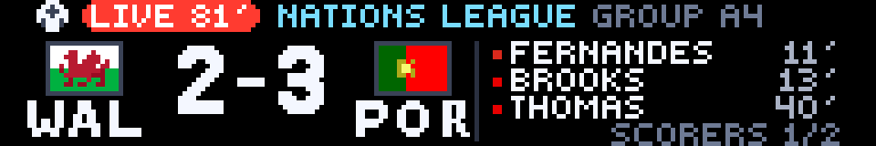
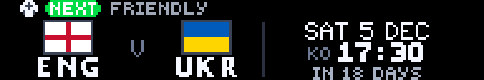
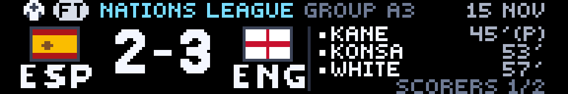
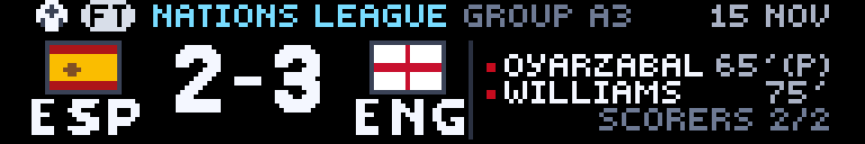
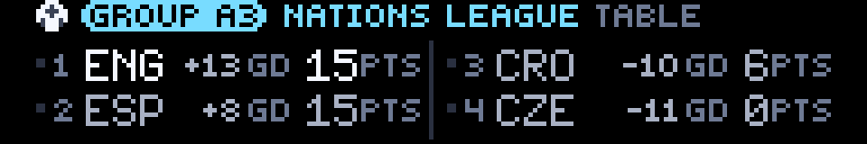
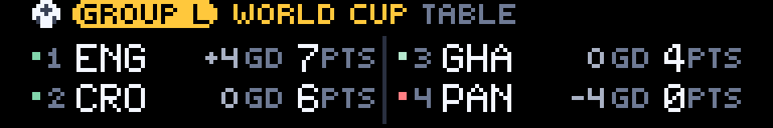

# International Football Scores

Live scores, fixtures, results with goalscorers, and group tables for national
teams in the **UEFA Nations League**, the **FIFA World Cup** (including
qualifiers) and the **UEFA European Championship** (including qualifiers).
Follow one country in every competition, or follow every match in one group.

Built for the 192 x 32 SCROLL. No API key needed.

Pages: `now`, `result`, `table`

## What it shows

### Now: the live score, or the next fixture

While a match you follow is on, the red **LIVE** chip carries the minute (or
**HT**), and the goalscorers so far are listed beside the score.

When nothing is live, the page shows the next fixture: both teams, the day and
date, the kickoff time in your time zone, and how many days away it is.

### Result: the latest final score and every scorer

Each scorer gets one row with their minutes. **(P)** marks a penalty and
**(OG)** an own goal. Extra time shows as **AET**, and a penalty shootout as
**FT PENS** with the shootout score under the result. When a match has more
than four scorers they page through, so nobody is left off:

### Table: the group standings

The table shows each team's position, goal difference and points, in two
columns. When you follow a team, it is lit and the others are dimmed. The
small square by each position is coloured by what that place means in the
competition (qualifies, playoff or relegation), where the feed says so.

Every page carries a flag for each team, and the competition name in its own
colour: sky blue for the Nations League, gold for the World Cup, blue for the
Euros.

## Settings

| setting | what it is |
|---|---|
| **Follow** | **A team** follows one country in every competition. **A group** follows every match in one group. Only the matching setting below is used. |
| **Team** | 86 national teams: every UEFA nation, plus every other team at the 2026 World Cup. Used when following a team. |
| **Group** | Nations League groups A1 to D2, World Cup groups A to L, World Cup qualifying (Europe) groups A to L, Euro groups A to F, and Euro qualifying groups A to L. Used when following a group. |
| **Include friendlies** | Off by default, so only the competitions above are shown. Turn it on to include friendlies too. |
| **Kickoff time format** | 24h or 12h. |
| **Time zone** | Kickoff times are shown in this zone, with daylight saving applied automatically. |

## Good to know

- **Groups that have not been drawn yet** show **NOT DRAWN YET** until the draw
  is made, for example Euro 2028 qualifying before its draw. Between tournaments
  the data feed keeps serving the previous edition, so a table more than a year
  old is treated as not drawn rather than shown as if it were current.
- **No fixtures, no results or no group** each get their own clear screen (for
  example **NO FIXTURES YET**) instead of a blank panel. If the scores cannot be
  reached, the panel says **SCORES UNAVAILABLE** and tries again on the next
  refresh.
- **Several group matches at once:** in group mode, simultaneous matches rotate
  one per refresh, with a counter such as **1/2** in the corner.
- **World Cup qualifying groups** can be picked for Europe only. Following a team
  from another confederation still shows that team's own qualifiers.
- **Refresh:** every 2 minutes, so live scores stay current.

## Data and artwork

- Scores, fixtures, scorers and tables come from ESPN's public soccer feeds.
- The flags are pixel art made from the public-domain flags on
  [flagcdn.com](https://flagcdn.com) (Wikimedia artwork), in two sizes: 15 x 10
  for score pages and 18 x 12 for fixtures. Every pixel is a solid flag colour.
  The USA flag is hand-drawn so its stripes survive at that size. Northern
  Ireland uses the Ulster Banner, as its football team does. Federation crests
  are not used, because they are each association's trademark.
