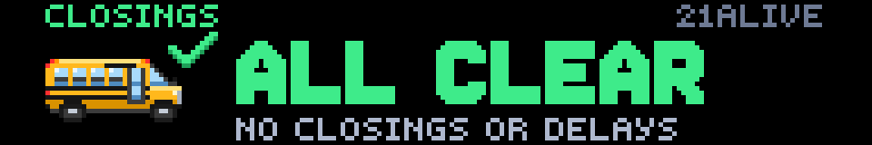
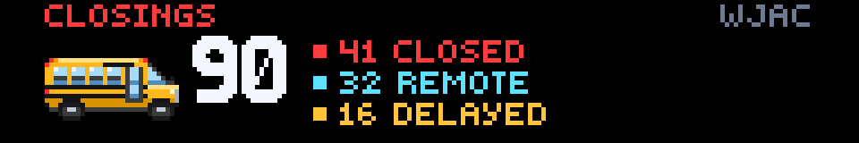
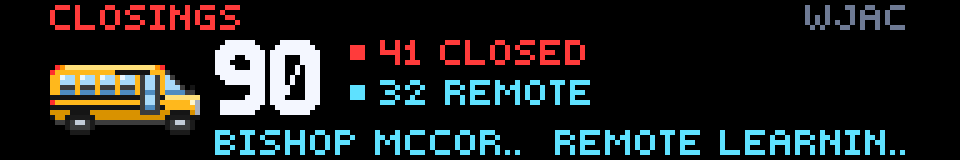
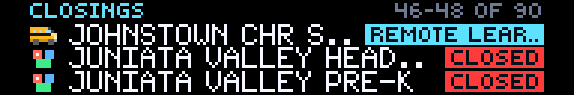
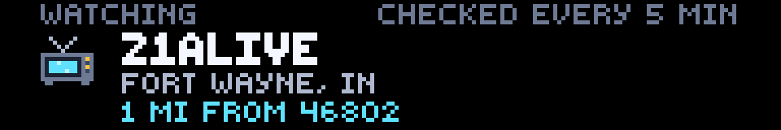

# Local Closings

**Created by Reyos** · Weather · 192×32 SCROLL · No API key needed

School, business, church and government **closings and delays** from your local TV station, on your Glance panel. Type your **ZIP code** and the app finds your station; add your **school's name** and its status shows first. On a snow morning you'll know at a glance: **ALL CLEAR**, or **90 closings: 41 closed, 32 remote, 16 delayed**.


> 💬 **Comments or suggestions?** Reach out to **Reyos** on Discord.

---

## Contents

- [At a glance](#at-a-glance)
- [Page 1: The board](#page-1-the-board)
- [Page 2: The closings list](#page-2-the-closings-list)
- [Finding your station](#finding-your-station)
- [Reading the panel](#reading-the-panel)
- [Settings](#settings)
- [Supported stations](#supported-stations)
- [How it works](#how-it-works)
- [Screens for every situation](#screens-for-every-situation)
- [What's new in 1.1](#whats-new-in-11)
- [Limitations](#limitations)
- [For developers](#for-developers)

---

## At a glance

| Page | What it shows |
|---|---|
| **1 · board** | **ALL CLEAR**, or **how many closings** your station lists and of which kind (closed, delayed, early dismissal, remote, other). With a school name set, **your school's status** on the bottom line. |
| **2 · closings** | **Three closings at a time**, each with an icon for the kind of place and a **status chip**. The list rolls on every refresh so the whole list comes round. When nothing is listed, **the station the app is watching** and how far it is from you. |

---

## Page 1: The board



**Nothing listed:** the school bus with a green check, **ALL CLEAR**, and *NO CLOSINGS OR DELAYS*. The station's name sits in the top right corner (`21ALIVE`).



**Closings listed** (a real snow day: WJAC Johnstown, PA, Jan 31, 2021):
- **Count:** the total in big numbers (`90`).
- **Breakdown by kind:** `41 CLOSED` in red, `32 REMOTE` in cyan, `16 DELAYED` in amber.
- **Hero art:**
  - **the school bus** when schools lead the list
  - **a storefront with a CLOSED sign** when businesses do
- **Header colour:** `CLOSINGS` takes the colour of the biggest group.



**With your school's name set:** the bottom line shows **your school** in cyan and **what the station says about it** (`REMOTE LEARNING` for Bishop McCort). It shows `NOT LISTED` in green when the station hasn't listed it.

---

## Page 2: The closings list



**Three closings at a time:**
- **Icon:** shows the kind of place.
- **Name:** shortened to fit (`CENTRAL` → `CTRL`, `HIGH SCHOOL` → `HS`).
- **Status chip:** on the right, in the status colour.
- **Position:** the header shows where you are in the list (`61-63 OF 90`).
- **Rolling:** each refresh shows the next three, so the whole list comes round.
- **Your school:** when set and listed, it stays **pinned at the top** in cyan.



**When nothing is listed,** this page doesn't repeat the board. It shows **which station the app is watching**, its city, and **how far it is from your ZIP code** (`1 MI FROM 46802`), so you can check the app picked the right one.

---

## Finding your station

Type your **ZIP code** and the app finds the **nearest closings source it can read**. The app has a list of **309 sources in 49 states and D.C.** (New Jersey is served by New York and Philadelphia stations):
- **TV stations:** 298 local stations.
- **Statewide and regional systems:** 11 lists that whole areas report to, covering every Rhode Island and Delaware district and much of the Northwest.

Each one was checked by running its closings page through the app's own reader.

**How it picks:**
1. **Locate the ZIP:** the free [zippopotam.us](https://zippopotam.us) lookup turns your ZIP into a location. A ZIP never moves, so this is cached for a month.
2. **Find the nearest station:** by straight-line distance.
3. **Read that station's list:** every 5 minutes.

**Coverage:** about half of U.S. ZIP codes are within 35 miles of a listed source, and 85 in 100 within 75 miles. The closest stations to some rural areas are in another market. If yours is one, or you prefer a different station, **paste that station's closings link** in the settings and it's used instead.

---

## Reading the panel

### Status colours

| Colour | Means | Examples |
|---|---|---|
| 🔴 Red | **Closed** | `CLOSED`, `CANCELLED`, "No school" |
| 🟡 Amber | **Delayed** | `2 HR DELAY`, `1.5 HR DELAY`, `OPENING LATE` |
| 🟠 Orange | **Early dismissal** | `EARLY DISMISSAL`, `CLOSING AT NOON` |
| 🔵 Cyan | **Remote** | `REMOTE LEARNING`, e-learning, NTI days |
| 🟡 Amber | **Other** | Anything else the station posts |

Listings that say the place is **open** ("Open", "No delay", "On time") are left out, because they aren't closings.

### Icons


From left to right:
- **The school bus** and **the storefront with its CLOSED sign:** the board's hero art.
  - **The bus** is drawn as a real American school bus seen from the door side: National School Bus Yellow, a hood and grille up front, black rub rails, split-sash windows, the folding entrance door, the `SCHOOL BUS` sign band, and amber and red warning lamps on the roof.
- **The list icons:**
  - **school**, the same bus in miniature
  - **business**, a shop with an awning
  - **church**, a steeple
  - **government**, a columned building
  - **daycare**, building blocks

The kind of place comes from the station's own category when it gives one ("School", "Business"), otherwise from the name ("ACADEMY", "BAPTIST CHURCH", "CITY OF…", "CHILD CARE").

---

## Settings

| Setting | Default | What it does |
|---|---|---|
| **ZIP Code** | `46802` | Your ZIP code. The app watches the closings page of the nearest station it can read. |
| **School Name** | `NONE` | Optional. Your school or organization, e.g. `WABASH CITY SCHOOLS`. If listed, its status shows on the board and first in the list. Matching ignores case and punctuation (`St. Mary's` = `ST MARYS` = `Saint Marys`) and only matches whole words (`LEE` matches `LEE ELEMENTARY`, not `OAKLEE ACADEMY`). |
| **Station Closings Link** | `NONE` | Optional. Paste any station's Closings & Delays page to use it instead of the ZIP code pick. `https://` and `www.` are optional, and capitals don't matter. |

The text settings default to `NONE` rather than blank so the Glance phone app can save them; `NONE` means "not set".

---

## Supported stations

Glance can't run the JavaScript that fills many closings tables, so the app reads the small feed each **closings system** loads behind the page:

| System | Example stations |
|---|---|
| **Gray GSync / NewsTicker** | 21Alive, WBRC, WSAZ, KCTV, KOLO, First Alert 4 St. Louis, NBC15 Madison, WAVE… |
| **Nexstar NewsTicker XML** | WGN Chicago (the Emergency Closing Center list most Chicago stations share), Count on 2 Charleston, Queen City News Charlotte |
| **TownNews / BLOX XML** | KOAM |
| **TownNews storm lists** | Wyoming News Now (Cheyenne, Casper and Scottsbluff). It posts one "School Closings and Delays" list per storm. The app reads the newest one while it's under 20 hours old; an older one means the storm has passed, so the board shows ALL CLEAR. |
| **Nexstar WordPress** (old and new layouts) | KSN, WIVB, NewsChannel 9 Syracuse, KRQE, ABC4 Salt Lake City, NEWS10 Albany, FOX 8 Greensboro, WHO 13… |
| **NBC owned stations** | NBC New York, NBC10 Philadelphia, NBC Boston, NBC Los Angeles, NBC Bay Area, NBC 7 San Diego, NBC 6 Miami… |
| **Scripps** | KOAA, WXYZ, Denver7, KPAX Missoula… |
| **FOX owned** | FOX 5 New York, FOX 29 Philadelphia, FOX 5 DC, FOX 2 Detroit, FOX 9, FOX6, FOX 4 Dallas, FOX 13 Seattle |
| **Sinclair** | WJLA, KOMO, 13WHAM, WJAC, WSBT, Local 12, FOX45 Baltimore, KRCG, WCYB… (30 stations) |
| **TEGNA** | WFAA, KARE 11, 9NEWS, WTHR… |
| **Hearst** | KMBC, WCVB, WTAE… |
| **CBS News stations** | WJZ, WBZ, KDKA, WCCO… |
| **Cox** | WSB-TV, KIRO 7, WSOC, WHIO, WPXI, Boston 25 |
| **Arc SchoolClosings** | 9&10 News |
| **NPG closings table** | ABC 17 Columbia, MO |
| **Statewide and regional systems** | **Rhode Island:** the RI Broadcasters Association list, which RI's TV and radio stations all share. **Delaware:** the state's own system, which every district and charter school reports to. **FlashAlert Newswire:** Portland, Seattle, Spokane, Tri-Cities/Yakima, Eugene, Bend, Medford/Klamath Falls, Boise and Colorado Springs. |

**What about radio?** Most commercial radio stations don't keep a closings list of their own. They read the TV station's list on air or post a news article. Where radio shares a real list, as with Rhode Island's, the app reads that list.

**Thin coverage:** Montana, Utah and Wyoming have only one or two sources each. Each was found by checking every TV station, radio group and newspaper site in those states. The other Montana and Utah stations post closings as news articles or hand-typed notes. FOX 13 Salt Lake's note still listed a Provo late start eleven months later, so it's left out. ZIP codes far from a source get the nearest one, which may be a long way off, or you can paste a link.

A station whose page uses another system shows **CAN'T READ THIS PAGE**. Paste a closings link from another local station instead. See [RESEARCH.md](RESEARCH.md) for how each system was found.

---

## How it works

**Refresh:** every **5 minutes**. Closings pour in early on storm mornings, and the panel keeps up.

**Requests per refresh:**
- **ZIP lookup:** one, cached for a month.
- **The station:** 1–5 requests, depending on its system.
- **Limit:** no path goes over Glance's limit of 8, and pages are cached so both pages share them.

**Nothing is made up:** the app only shows what the station published. A school missing on a day with other closings means the station didn't list it.

---

## Screens for every situation

| Situation | Board | List page |
|---|---|---|
| Nothing listed | **ALL CLEAR** · `NO CLOSINGS OR DELAYS` | The station being watched, and how far away |
| Closings listed | The count and breakdown | Three at a time, rolling |
| Your school is listed | Its status on the bottom line | Pinned at the top in cyan |
| Your school isn't listed | `NOT LISTED` in green | |
| No ZIP code set | `ADD YOUR ZIP CODE` | `NO STATION YET` |
| ZIP code not found | `ZIP CODE NOT FOUND` · `CHECK 00000…` | `CHECK YOUR ZIP CODE` |
| Station page didn't load | `STATION OFFLINE` · `TRYING AGAIN SOON` | `PAGE DID NOT LOAD` |
| Unsupported page | `CAN'T READ THIS PAGE` | `CAN'T READ THIS PAGE` |

---

## What's new in 1.1

**New**
- **ZIP code setup:** type a ZIP code instead of hunting down a station's closings link. The link setting stays as an override.
- **Two pages instead of six:** a board and a rolling list. The old five item pages showed the same ALL CLEAR screen five extra times on a normal day.
- **The station card:** when nothing's listed, page 2 shows which station is being watched and how far away it is.
- **New art:** a true-to-life school bus, the storefront, an icon for each kind of place, and a TV.
- **More stations:** the list grew to 309 sources, and every state except New Jersey has its own (New Jersey is covered from New York and Philadelphia). New this version:
  - **8 FOX owned stations**
  - **28 Sinclair stations**
  - **statewide lists:** Rhode Island and Delaware
  - **9 FlashAlert regions** across Oregon, Washington, Idaho and Colorado
  - **The first sources in Montana, Utah and Wyoming:** KPAX Missoula, ABC4 Salt Lake City, and Wyoming News Now's storm lists
  - **Cox stations** WSB-TV, KIRO 7 and WSOC
  - **Big markets that had nothing:** Chicago (WGN, the region's shared list), Los Angeles, the Bay Area, San Diego and Miami (NBC), Albany (NEWS10)
  - **More regional stations,** including KRCG and ABC 17 in mid-Missouri, WCYB Bristol, WVVA Bluefield, FOX 8 Greensboro, WHO 13 Des Moines, KOIN Portland and NBC15 Madison
- **Everything inside the safe zone:** content now stays within x 10–181, so the app no longer runs into the apps around it.
- **A new status group:** early dismissal is its own orange group.

**Fixed**
- **Refresh:** every 5 minutes instead of once an hour, so you'll see storm-morning closings much sooner.
- **Saving on the phone:** School Name and the link now default to `NONE`. A blank text setting couldn't be saved from the Glance phone app.
- **Long lists:** lists over 40 closings were cut short, and a school past the 40th showed a false **NOT LISTED**. Whole feeds are now read, and the board uses the station's own total.
- **Wrong statuses on some stations:** names and statuses could pair up with the wrong row. NewsChannel 9 Syracuse showed "BACK TO TOP" as a status.
- **A phantom closing:** WSPA showed a "MORE LOCAL NEWS" closing that didn't exist.
- **Cox stations:** WSB-TV showed NOT SUPPORTED, even with a closing listed. It now reads the new Cox layout, and a closing tagged only "Other" takes its real status from the details (`CLOSED`).
- **Possible crash:** a TownNews page linking many feeds could pass Glance's 8-request limit and crash.
- **Status wording:**
  - "No delay" and "Not closed" were shown as closings.
  - "1.5 hour delay" showed as "15 HR".
  - "No school" wasn't counted as closed.
  - "Closing at noon" showed as CLOSED.
- **School matching:**
  - It matched inside other words (`LEE` → `OAKLEE`).
  - Punctuation broke matches (`St. Mary's`).
- **Characters:** curly quotes and `&#8217;`-style codes showed as raw text.
- **Links:** these failed before and now work:
  - links without `www.`
  - links in all capitals
  - links ending in `#top`
- **Text overflow:** error text and long status chips ran off the edge of the panel.
- **Nexstar stations:** about 30 stations (KSN, WIVB, KRQE…) read as offline once Nexstar started blocking page requests. The app now reads their closings data directly.
- **FlashAlert:** statuses were lost (`REPORTED` instead of `CLOSED`).
- **Sinclair pages:** the older table layout and some "nothing listed" wording weren't recognised.
- **Pasted links** now show the station's name (`FOX 29`, `WJLA`) instead of part of the web address.
- **Nexstar "closings-and-delays" pages** (NEWS10 Albany) read as offline: the address looked like a TownNews one, and the Nexstar reader was never tried.

---

## Limitations

- **Nearest isn't always local:** the ZIP pick is the nearest listed station, which can be in a neighbouring market for some rural ZIP codes. Paste your preferred station's link if so.
- **Only what's published:** the app shows what your station posts. If a school isn't on that station's list, it can't appear.
- **Five-minute snapshots:** the panel updates every 5 minutes, not instantly.
- **Supported systems only:** stations on other closings systems can't be read.
- **Thin coverage in Montana, Utah and Wyoming:** one or two sources each. See [Supported stations](#supported-stations).
- **ABC 17's table:** ABC 17 Columbia's closings page has only ever been seen empty. The app reads its rows the generic way (name in the first cell, status from the first cell that names one), so the first busy day there is its first real test.
- **Storm lists:** Wyoming News Now's list is a post written by hand. The app reads it the way it's written (`Name - Status`), and only for 20 hours after it's posted.
- **Very long lists:** the board counts up to 250 closings, so a huge statewide day (Rhode Island can pass 600) shows `250`.
- **Busy sites:** a station's site can briefly refuse requests or answer slowly. The panel shows `STATION OFFLINE` and tries again on the next refresh.

---

## For developers

| | |
|---|---|
| **Size** | 192×32 (SCROLL) |
| **Pages** | `board`, `closings` |
| **Refresh** | 300 seconds (free-text inputs need 300 s or more) |
| **Requests** | 1 ZIP lookup (cached 30 days) + 1–5 for the station, never more than 8 |

**ZIP lookup:** `GET https://api.zippopotam.us/us/<zip>` → `places[0].latitude/longitude`. The nearest entry in `STATIONS` is found with an equirectangular distance. Starlark has no math module, so `cos` uses a Taylor series and `sqrt` uses Newton's method.

**The station list:** `STATIONS` is `[name, city, state, lat, lng, closings page]`. A bare `host/path` is fetched on `www.`, and sites that don't use `www` are stored with `https://` in front. Each page was run through the app's reader, by its ZIP lookup address, before it was listed. A station that only answered "unsupported" or "unavailable" was left out.

**Storm lists:** a TownNews closings section (`/weather/closings/`) that has no closings app is read through its search feed, `/search/?f=json&t=article&c=weather/closings&l=1&s=start_time&sd=desc`. It returns the newest article with its `starttime` and its body as HTML lines. Each line is split at the first ` - ` piece that names a status, so `Eastern Wyoming College - Torrington Campus - 2 Hour Delay` keeps the campus in the name. An article over `STORM_LIST_HOURS` (20) old counts as ALL CLEAR.

**Preview and check it locally:**

```powershell
gdn studio apps/local-closings
gdn render apps/local-closings --page 1 --input "zip=19901"
gdn render apps/local-closings --page 2 --input "zip=98101"
gdn render apps/local-closings --page 1 --now 2025-02-19T14:00:00 --input "zip=82001"
gdn render apps/local-closings --page 1 --input "closingsurl=www.wsbtv.com/weather/school-closings/"
gdn validate apps/local-closings
```

---

**Created by Reyos** · Comments or suggestions? Reach out to **Reyos** on Discord.

Built for the [Glance Developer Network](https://github.com/glance-led-dev/glance-dev-network).
