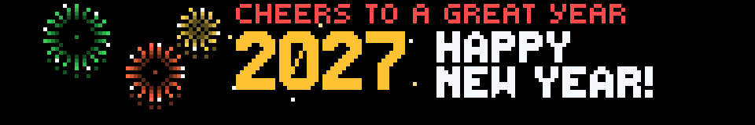
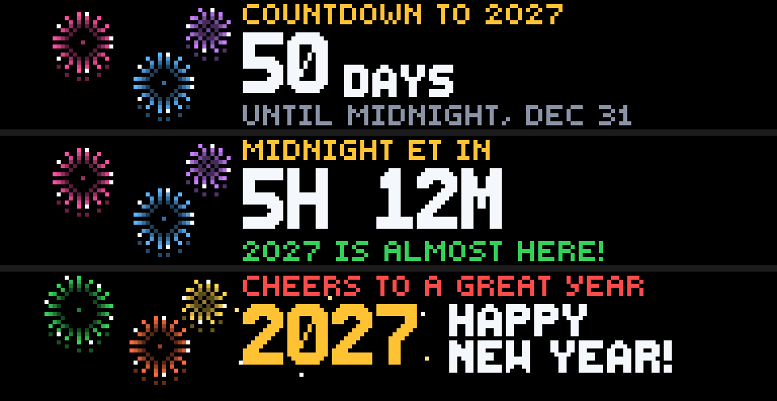
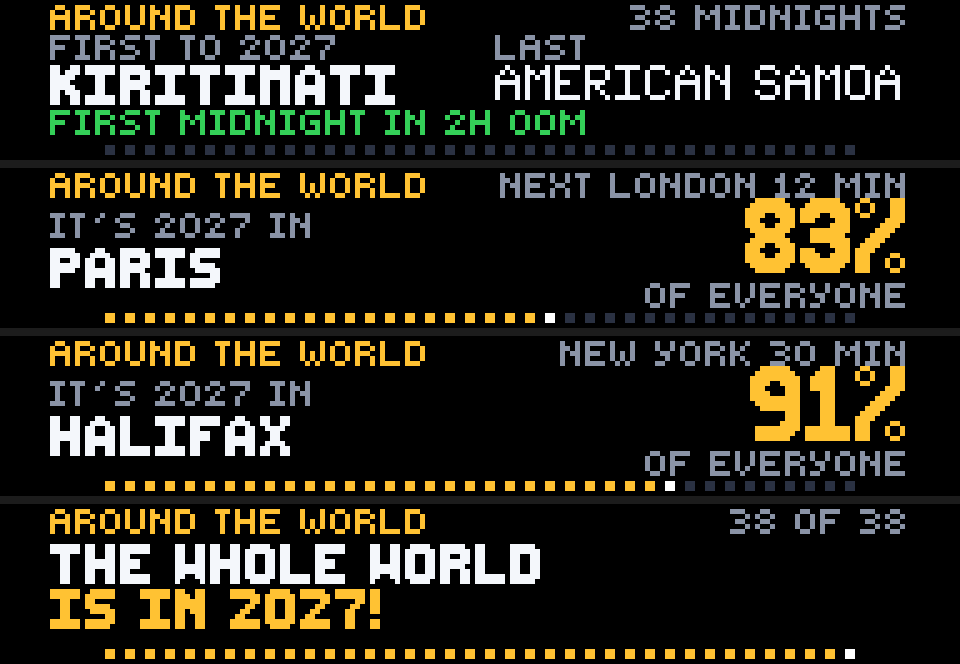
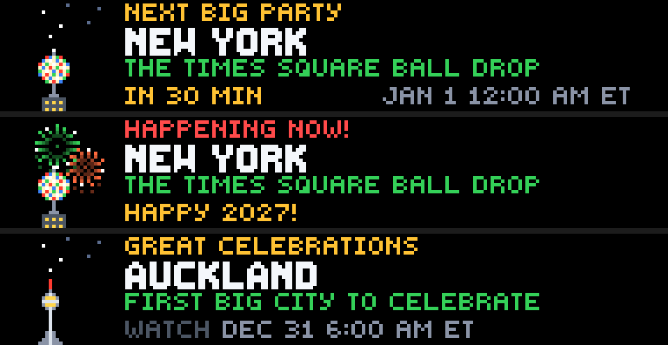
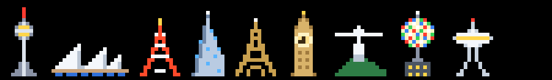

# New Year's Eve

**Created by Reyos** · Lifestyle · 192×32 SCROLL · No API key needed

Midnight around the world on your Glance panel. Count down to **your** New Year, watch midnight sweep through all **38 time zones**, from Kiritimati to American Samoa, and catch the **great celebrations** as they happen: Sydney's harbour, Big Ben, Rio's Copacabana and the **Times Square ball drop**. Fireworks included.



> 💬 **Comments or suggestions?** Reach out to **Reyos** on Discord.

---

## Contents

- [At a glance](#at-a-glance)
- [Page 1: Your midnight](#page-1-your-midnight)
- [Page 2: Around the world](#page-2-around-the-world)
- [Page 3: The great celebrations](#page-3-the-great-celebrations)
- [The pixel art](#the-pixel-art)
- [Settings](#settings)
- [How it works](#how-it-works)
- [Screens for every situation](#screens-for-every-situation)
- [Limitations](#limitations)
- [For developers](#for-developers)

---

## At a glance

| Page | The rest of the year | New Year's Eve |
|---|---|---|
| **1 · midnight** | **Days** until midnight, Dec 31 | **Hours and minutes** to midnight in your time zone, then **HAPPY NEW YEAR** with fireworks |
| **2 · world** | Who's **first** and **last** to celebrate | Where it's **already the new year**, the **share of the world's people** in it, the next city, and a dot for each of the **38 time zones** turning gold |
| **3 · party** | A **great celebration** each hour, with when to watch it live in your time | The **next big party** counted down, then **HAPPENING NOW!** with fireworks over the landmark |

---

## Page 1: Your midnight



1. **All year:** **COUNTDOWN TO 2027**, with the days until midnight on December 31 in big numbers.
2. **The last day:** **MIDNIGHT ET IN** **5H 12M**, then minutes. In the last ten minutes it says *GET READY TO COUNT DOWN!*, and in the final minute *ANY SECOND… 10… 9… 8…*
3. **Midnight:** a gold, sparkling **2027** with **HAPPY NEW YEAR!** and fireworks, all New Year's Day.

The fireworks change colour every minute, so every refresh is a new show.

---

## Page 2: Around the world



On December 31, midnight crosses the planet through **38 time zones in 26 hours**.

**Along the bottom:** one **dot for each time zone**, first to last. Each turns **gold** when midnight reaches it, and the newest one shines white.

**What the page shows through the day:**

1. **Before it starts:** who's **first** to the new year (**Kiritimati**, in Kiribati, at UTC+14) and who's **last** (**American Samoa**), plus *FIRST MIDNIGHT IN 2H 00M* on the day.
2. **During the sweep:**
   - **IT'S 2027 IN** and the latest city to strike midnight (Sydney, Tokyo, Paris…)
   - the **next** one and how long until it
   - how much of the world is already in the new year: **83% OF EVERYONE**
3. **When it's done:** **THE WHOLE WORLD IS IN 2027!** with every dot gold.

"Of everyone" is the share of the world's people living in the time zones that have already reached midnight. Most of the world sees in the new year before the Americas do, which is why the number is already high by the time London celebrates.

---

## Page 3: The great celebrations



Nine of the world's most famous New Year's celebrations, each with its landmark:

| | City | Celebration |
|---|---|---|
| Sky Tower | **Auckland** | The first big city to celebrate |
| Opera House | **Sydney** | Harbour Bridge fireworks |
| Tokyo Tower | **Tokyo** | Temple bells ring 108 times |
| Burj Khalifa | **Dubai** | The Burj Khalifa light show |
| Eiffel Tower | **Paris** | The Eiffel Tower sparkles |
| Big Ben | **London** | Big Ben strikes midnight |
| Christ the Redeemer | **Rio de Janeiro** | The world's biggest party, on Copacabana Beach |
| The ball | **New York** | The Times Square ball drop |
| Space Needle | **Seattle** | Space Needle fireworks |

**On New Year's Eve:**
- **Coming up:** **NEXT BIG PARTY**, with the countdown (`IN 30 MIN`) and when it happens in your own time (`JAN 1 12:00 AM ET`).
- **At midnight there:** **HAPPENING NOW!** for 15 minutes, with fireworks over the landmark and *HAPPY 2027!*

**The rest of the year:** a different celebration every hour, with **when to watch it live** in your time zone (e.g. *WATCH DEC 31 6:00 AM ET* for Auckland), so you can plan your New Year's Eve viewing.

---

## The pixel art



- **The landmarks:** nine hand-drawn and shaded, from left to right:
  - Auckland's **Sky Tower**, with its glowing observation deck
  - Sydney's **Opera House** sails over the harbour
  - **Tokyo Tower** in red and white
  - Dubai's **Burj Khalifa**, with lit windows
  - The **Eiffel Tower**
  - **Big Ben**, with its lit clock face
  - **Christ the Redeemer** on Corcovado
  - The **Times Square ball**, faceted in colour, on its pole
  - Seattle's **Space Needle**
- **Fireworks:** real bursts, not stars. Each is a ring of sparks with trails, white glints and drooping tails, in six colours. Their size, position and colour change every refresh.
- **The night sky:** stars twinkle over each landmark until its midnight comes.
- **2027:** in gold, with sparkles.

---

## Settings

| Setting | Options | What it does |
|---|---|---|
| **Your time zone** | **Eastern** *(default)*, **Central**, **Mountain**, **Pacific**, **Alaska**, **Hawaii**, **Atlantic**, **Newfoundland**, **UK and Ireland** | Sets your countdown to midnight, and the times shown on the celebrations page |

---

## How it works

**No data feed at all.** Every midnight is calculated from the time zones themselves, so the app **can never go offline** and refreshes **every minute**.

**The 38 time zones:** each uses its **December** offset, which includes daylight saving where it's summer: New Zealand +13, Sydney +11, Adelaide +10:30, Chile −3.
- **First:** Kiritimati (Kiribati) at UTC+14, then Auckland, the first big city.
- **Last:** American Samoa, the last inhabited place, at UTC−11. After it comes Baker Island at UTC−12, which is uninhabited.

**Population shares:** approximate, from each time zone's population in millions. The figure is meant as "about 83% of the world", not a census.

**Refresh:** every **60 seconds**. Glance allows that for apps without live data and with only pick-list settings (9 options).

---

## Screens for every situation

There's no data feed, so there's no offline screen. The panel always shows the right screen for the moment:

| When | midnight | world | party |
|---|---|---|---|
| Most of the year | `COUNTDOWN TO 2027` · **50 DAYS** | First (**Kiritimati**) and last (**American Samoa**) | A celebration each hour · `WATCH DEC 31 6:00 AM ET` |
| From Dec 30, 6 AM ET | Days, then **hours and minutes** for the last 24 hours | `FIRST MIDNIGHT IN 2H 00M` once it's under a day away | `NEXT BIG PARTY` · `IN 3H 00M` |
| During the sweep | `MIDNIGHT ET IN 5H 12M` | `IT'S 2027 IN PARIS` · **83%** · dots turning gold | `HAPPENING NOW!` with fireworks, for 15 minutes |
| Last 10 minutes | `GET READY TO COUNT DOWN!` | | |
| Last minute | `ANY SECOND` · `10... 9... 8...` | | |
| Your midnight, all New Year's Day | **2027 HAPPY NEW YEAR!** with fireworks | | |
| After the last time zone | | `THE WHOLE WORLD IS IN 2027!` | Back to a celebration each hour, for next year |

---

## Limitations

- **One-minute steps:** the countdown moves in whole minutes. The panel can't show a seconds countdown, so the last minute reads *ANY SECOND*.
- **Rounded population shares:** time zones don't follow borders exactly, so the percentage is an estimate.
- **US, Canada and UK zones:** the time-zone setting covers these. The world and celebration pages work for everyone.

---

## For developers

| | |
|---|---|
| **Size** | 192×32 (SCROLL) |
| **Pages** | `midnight`, `world`, `party` |
| **Refresh** | 60 seconds (no live data, one dropdown with 9 options) |
| **Requests** | None |

**The maths:** midnight for year *Y* in a zone with offset *o* minutes is `Jan 1 Y 00:00 UTC − o`. The world is "heading into" year `Y = year(now − 12 h) + 1`, which stays put until the last zone (UTC−12) has struck midnight.

**Fireworks** are precomputed burst tables (`BURSTS`, radii 5–8). Each entry is `[dx, dy, shade]`, and the shade indexes a colour's `[core, faint, mid, body, tip, glint, tail]`. Starlark has no trigonometry, so the geometry is baked in.

**Preview any moment:**

```powershell
gdn studio apps/new-years-eve
gdn render apps/new-years-eve --page 2 --now 2027-01-01T04:30
gdn render apps/new-years-eve --page 3 --now 2027-01-01T05:03 --input "zone=PACIFIC"
gdn validate apps/new-years-eve
```

---

**Created by Reyos** · Comments or suggestions? Reach out to **Reyos** on Discord.

Built for the [Glance Developer Network](https://github.com/glance-led-dev/glance-dev-network).
