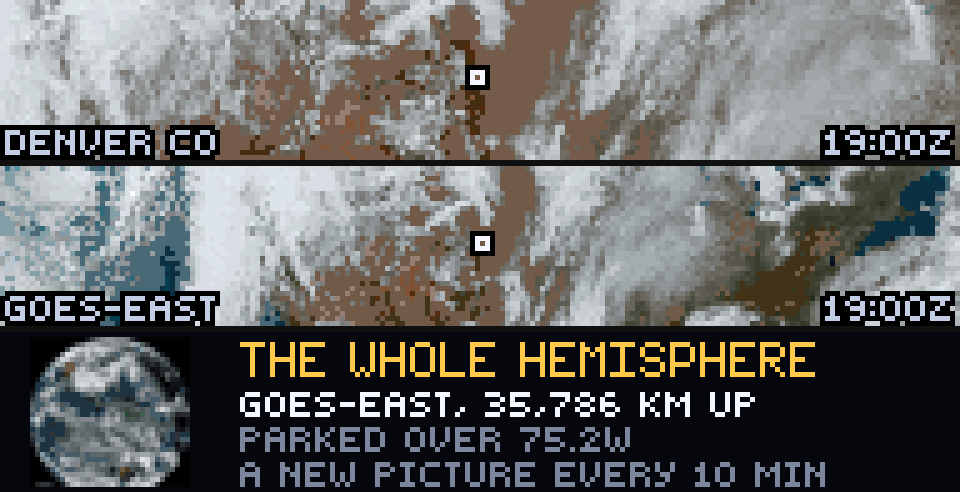

# Overhead

A live satellite view of your own patch of the Earth on a **192x32** panel.
GOES-19 sits over 75.2W and GOES-18 over 137.0W, both 35,786 km up, and
they photograph the Americas every ten minutes. This puts your corner of
that picture on the glass, full bleed.



No key, no account. Both sources are public.

## The three pages

**close** — your region, centred on your ZIP code, with a small target
marking the spot. The clouds are where they actually are: look out of the
window, then look at the panel.

**wide** — the same place pulled back to a continental strip, so you can
see the system your weather is part of rather than just the edge of it.

**disk** — the whole hemisphere as the satellite sees it, with a note on
where the thing taking the picture is parked.

## How a photograph gets onto a panel

This is the part worth knowing about, because at first glance it is
impossible. `http.get` carries text, not bytes, and `c.image()` only reads
files shipped inside the app — so an image from the internet has no way in.

The way through is [images.weserv.nl](https://images.weserv.nl). It will
fetch any public image, resize it to exactly 192x32 and re-encode it as a
PNG with **stored** (uncompressed) deflate blocks, handed back as base64
text. That last part is the trick: with `l=0` there is nothing to inflate,
so the decoder in `app.star` is forty lines rather than a zlib
implementation. The technique is cfdmb's — [`rain-watch`](../rain-watch)
reads weather radar exactly this way, and it is the reason this app exists
at all.

## Which picture, and which frame

NASA's [GIBS](https://nasa-gibs.github.io/gibs-api-docs/) serves GOES
imagery over WMS, which takes an arbitrary bounding box and output size. So
the frame can be centred on a ZIP code at any scale, with no tile stitching
and no projection maths beyond one cosine to stop the longitude span from
stretching.

GIBS lists a frame in its time index slightly **before** the pixels exist,
and the placeholder is a 104-byte transparent PNG — which the proxy
faithfully re-encodes into a full-size black one, so no response-size check
can catch it. Two things follow, and both are in the code:

- the newest listed frame is skipped by default, and
- a frame with no light in it at all is treated as missing and the app
  steps back ten minutes and asks again, up to three times.

Asking for an explicit timestamp matters too. Letting GIBS pick the default
time failed **two renders in ten** in testing; an explicit timestamp did not
fail once in ten.

## How current is it

About an hour behind the satellite, which is how far behind GIBS runs. That
sounds worse than it is: at the `NORMAL` setting one pixel is 17 km, so an
hour of a weather system's travel is two or three pixels.

If the newest frame ever falls more than three hours behind, the panel stops
showing a time and says how old the picture is, in amber. It would rather
admit to being stale than quietly pretend.

## Settings

| Setting | What it does |
|---|---|
| **US ZIP code** | Where the view is centred. GOES-East is used east of about 112W and GOES-West beyond it, so Alaska and Hawaii work. |
| **How close** | `TIGHT`, `NORMAL` or `WIDE` on the first page — about 330, 550 or 890 km from top to bottom. |
| **Mark your spot** | The target at your ZIP code, on or off. |

A 6:1 panel is wider than it feels: 32 rows of 5 degrees is 555 km tall,
which at the same scale makes the picture some 3300 km across. `NORMAL`
already spans most of the width of the lower 48.

## Data sources

| Source | Used for | Cached |
|---|---|---|
| `gibs.earthdata.nasa.gov` (WMS) | the regional and continental frames | 300s |
| `gibs.earthdata.nasa.gov` (time index) | which frame is the newest | 300s |
| `cdn.star.nesdis.noaa.gov` | the full-disk picture | 300s |
| `api.zippopotam.us` | ZIP code to latitude and longitude | 30 days |

`refresh` is 600s, matching the satellite's ten-minute cadence. The region
pages make two calls on a good render and at most four if the newest frames
come back empty; the limit is eight.

## When something is missing

| Screen | Meaning |
|---|---|
| `NO LOCATION` / `CHECK THE ZIP CODE` | the ZIP is not five digits |
| `NO LOCATION` / `NO SUCH US ZIP CODE` | the lookup does not know it |
| `NO LOCATION` / `ZIP LOOKUP DID NOT ANSWER` | zippopotam did not answer |
| `NO FRAME INDEX` / `GIBS DID NOT ANSWER` | the time index did not answer |
| `NO PICTURE` / `THE GOES-EAST FRAME DID NOT ARRIVE` | three frames in a row came back empty |
| `NO DISK` / `NOAA STAR DID NOT ANSWER` | the full-disk image did not answer |

There is no demo mode. A panel whose whole purpose is to show you the real
sky has no business inventing one.

## Notes on the drawing

192x32 is 6144 pixels, while a page may emit at most 4096 draw ops and no
single bitmap may hold more than 4096 cells. `c.sprite` emits one bitmap per
colour in its legend, so the frame is quantised to at most 80 colours and
laid down in three 64-wide chunks — a few dozen bitmaps of 2048 cells each,
inside both limits.

The quantiser has to run in Starlark, which rules out a nearest-colour
search: 6144 pixels against 80 colours is half a million comparisons. So the
buckets are **fixed** and cheap — 32 steps of grey for anything
near-neutral, which is most of a satellite picture, and 48 coarse chroma
cells for land, city lights and the sunlit limb — while the **colour** of
each bucket is the mean of the pixels that landed in it, which costs one
running total. Fixed buckets, adaptive palette, one pass. Measured against
the original frame it lands about three times closer than a uniform 4x4x4
colour cube, which turns cloud into confetti.

Near the end of the map — Alaska, Hawaii — the bounding box is slid back
onto it rather than narrowed, because narrowing it would collapse the wide
page onto the close one. The viewer stops being dead centre when that
happens, which is why the target is positioned from the bounding box rather
than pinned to the middle. At the far edge of what a satellite can see you
may catch the curve of the disk itself in a corner, black and sharp. That is
the edge of the world as GOES can see it, not a fault.

Nothing on these pages is a label standing in for a thing. It is the thing.

## Running it

From the repository root:

```bash
gdn studio apps/overhead
```

Rendering one page:

```bash
gdn render apps/overhead --page 2 --input "zip=80202"
```

To see the no-data screens, set `GDN_HTTP_OFFLINE=1` first — every
`http.get` then fails, which is what the publish-time validator does.

If `gdn` is not on `PATH`, use `python -m gdn` in its place.

The preview images show a daylight pass over Colorado; the app renders
whatever the satellite is looking at when your panel asks.

Imagery courtesy of NOAA and NASA's Global Imagery Browse Services, part of
the Earth Observing System Data and Information System.

Built for the [GLANCE Developer Network](https://github.com/glance-led-dev/glance-dev-network).
