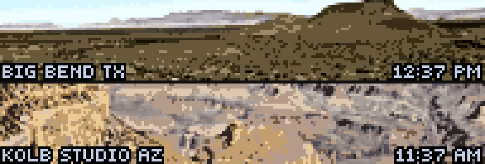
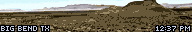
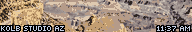

# Parks Live

**Created by Reyos** · Travel · 192×32 SCROLL · No API key needed

A window onto a national park, live. **Eighteen public webcams** from Acadia to Kīlauea, and the panel shows whichever one **the sun is highest over right now** — first light over the Maine coast, mid-morning on the rim of the Grand Canyon, afternoon in Denali, the last of the day on Kīlauea.



> 💬 **Comments or suggestions?** Reach out to **Reyos** on Discord.

---

## Contents

- [At a glance](#at-a-glance)
- [Page 1: The view](#page-1-the-view)
- [Page 2: Elsewhere](#page-2-elsewhere)
- [The eighteen windows](#the-eighteen-windows)
- [When every window is dark](#when-every-window-is-dark)
- [Settings](#settings)
- [Why it follows the sun](#why-it-follows-the-sun)
- [How it works](#how-it-works)
- [Screens for every situation](#screens-for-every-situation)
- [Limitations](#limitations)
- [Credits](#credits)
- [For developers](#for-developers)

---

## At a glance

| Page | What it shows |
|---|---|
| **1 · view** | **The best-lit park right now**, full bleed, with its name and **the local time at the camera** |
| **2 · elsewhere** | **The next best lit**, so the rotation gives you two places at once — or a second park you pin yourself |

---

## Page 1: The view



Whichever of the eighteen cameras has the sun highest over it at this minute, filling the panel.

- **The picture:** a live frame, sharpened for the panel, never more than a few minutes old.
- **The caption:** the park and state on the left, **the local time at that camera** on the right — not your time. Arizona and Hawaiʻi do not keep daylight saving, and the app knows it.
- **It moves west through the day.** Leave it alone and the panel walks across the country with the sun.

You can pin it to one park instead, and it will stay there whether the sun is up or not.

---

## Page 2: Elsewhere



The next best-lit camera after page 1 — so you get two places, usually a couple of time zones apart.

This page can be pinned too, independently. Whatever one page is showing is never offered to the other, so you will not get the same park twice.

---

## The eighteen windows

| Window | Where | Local zone |
|---|---|---|
| **Acadia** | Maine | Eastern |
| **Shenandoah** | Virginia | Eastern |
| **Great Smoky Mtns** | Tennessee | Eastern |
| **Mammoth Cave** | Kentucky | Central |
| **Theodore Roosevelt** | North Dakota | Central |
| **Big Bend** | Texas | Central |
| **Glacier Basin** | Rocky Mountain NP, Colorado | Mountain |
| **Yellowstone** | West entrance, Wyoming | Mountain |
| **Grand Canyon** | Yavapai Point, looking northwest | Mountain, no DST |
| **Kolb Studio** | Grand Canyon, north over the Battleship | Mountain, no DST |
| **Glacier** | St Mary, Montana | Mountain |
| **Yosemite** | California | Pacific |
| **Lassen Volcanic** | California | Pacific |
| **Mount Rainier** | Washington | Pacific |
| **North Cascades** | Washington | Pacific |
| **Olympic** | Washington | Pacific |
| **Denali** | Alaska | Alaska |
| **Kīlauea** | Hawaiʻi | Hawaiʻi, no DST |

Most of these are the Park Service's **air-quality cameras**. They exist to measure visibility, which means every one is pointed at the best view in the park on purpose.

Acadia at 68W to Kīlauea at 156W is **88 degrees of longitude** — close to six hours — which is what keeps the panel lit for most of the day.

---

## When every window is dark

For about seven hours a night there is genuinely nothing in the United States to look at, and the app does not pretend otherwise.

- **Page 1** shows `EVERY WINDOW IS DARK`, names the park that will catch the sun first, and counts down to it.
- **Page 2** shows `NEXT LIGHT`: the three windows closest to sunrise, with their countdowns.

Both are drawn from arithmetic alone, so they work with the network down.

---

## Settings

| Setting | Options | What it does |
|---|---|---|
| **Which window** | **FOLLOW THE SUN** *(default)*, or any of the eighteen parks | Follow the sun and page 1 is always the best-lit camera. Pick a park to stay there, dark or not |
| **The other window** | **THE NEXT BEST LIT** *(default)*, or any of the eighteen parks | The same choice for page 2. The two settings are independent: pin one and let the other roam, pin both, or let both follow the sun |
| **Clock** | **12 HOUR** *(default)*, **24 HOUR** | The time on the picture is the local time **at the camera**, not yours |

**GRAND CANYON** looks northwest from Yavapai Point; **KOLB STUDIO** looks north across the Battleship formation from the head of the Bright Angel trail.

---

## Why it follows the sun

A webcam panel sounds simple until you look at one at two in the morning.

Of twenty cameras checked at 06:45 UTC, **every single one** was black, fogged in, or showing infrared mush. Pointing a panel at one favourite camera gives you something lovely for half the day and a dark rectangle for the other half.

Ranking the cameras by the sun's altitude and showing the brightest fixes that, and costs nothing — solar position is arithmetic, not a request. Pinning a park is still there for anyone who wants their own view and does not mind the dark.

---

## How it works

**Data:** public cameras from two federal agencies and a park conservancy, with no account or API key:

| Source | Cameras | Cached |
|---|---|---|
| [NPS Air Resources Division](https://www.nps.gov/subjects/air/webcams.htm) | Eleven visibility cameras | 4 min |
| `nps.gov/webcams-*` | Four park cameras | 4 min |
| [Grand Canyon Conservancy](https://www.nps.gov/grca/) via pixelcaster | Kolb Studio | 4 min |
| [USGS Hawaiian Volcano Observatory](https://volcanoes.usgs.gov/) | Kīlauea | 4 min |

**Refresh:** every **5 minutes**. One request when the first camera answers with a believable frame, at most three if it does not.

**Not every camera tells the truth,** and none of the ways it can lie is an HTTP error:

- it can be **dead** and serve black;
- it can be **frozen** and serve yesterday's sunshine at midnight — Zion and Isle Royale both do this, byte for byte;
- or it can serve a **flat card reading IMAGE UNAVAILABLE**, which is bright, plausible and has no landscape in it at all.

So every frame is checked on arrival against where the sun actually is, and against how much colour is in it. Sun well up and the frame nearly black means the camera is down. Long past dusk and still sunlit means the frame is stale. Fewer than eight colours in the whole picture means there is no landscape in it. Any of those and the app moves to the next camera rather than pass it off as live.

---

## Screens for every situation

| Situation | What you see |
|---|---|
| The sun is below the horizon at all eighteen | `EVERY WINDOW IS DARK` · the next park to catch the sun, and the countdown |
| The same, on page 2 | `NEXT LIGHT` · the three windows closest to sunrise |
| A pinned camera does not answer | `NO PICTURE` · `<PARK> DID NOT ANSWER` |
| A pinned camera's frame fails the checks | `NOT LIVE` · `THE <PARK> FEED HAS STOPPED` |
| No camera answers with a live frame | `NO PICTURE` · `NO CAMERA ANSWERED WITH A LIVE FRAME` |

**There is no demo mode.** A window that invents a view is not a window.

---

## Limitations

- **There is still a dark stretch.** About seven hours a night, nowhere in the United States is lit. No American public camera network reaches further west than Hawaiʻi.
- **Cameras go down.** They are maintained by park staff, not by a service with an uptime target. The app detects it and moves on, but a pinned park can simply be unavailable.
- **Weather happens to views.** A camera can be perfectly live and show nothing but fog. That is an honest picture of the park, and the app will not hide it.
- **The frame is 6:1 and the cameras are 16:9**, so under a third of each frame is on the panel. Each camera has its focal point set by hand to keep the best of the view.
- **US parks only.**

---

## Credits

- **Webcams:** the **US National Park Service**, including the Air Resources Division's visibility camera network.
- **Kīlauea:** the **USGS Hawaiian Volcano Observatory**.
- **Kolb Studio:** the **Grand Canyon Conservancy**, via the park's own webcam pages.
- **Image resizing:** [images.weserv.nl](https://images.weserv.nl).
- **The trick that makes photographs possible on a panel at all** is **cfdmb's**, from `rain-watch`.

All imagery is from US federal sources or a park partner, in the public domain or freely republishable.

---

## For developers

| | |
|---|---|
| **Size** | 192×32 (SCROLL) |
| **Pages** | `view`, `elsewhere` |
| **Refresh** | 300 seconds |
| **Requests** | 1 per page normally, 3 at most |
| **Scene** | 0.66 MiB of the 1 MiB budget |

**Solar position** is computed from the low-precision Astronomical Almanac formulae, good to about 0.01°: declination, hour angle and altitude for each camera, plus the next sunrise from the hour angle at the horizon. Checked against the almanac before it was trusted — declination −20.80° against −20.7, the solstices at ±23.44°, London's equinox noon altitude 38.5° against 38.5. No requests, so ranking eighteen cameras is free.

**Getting a photograph onto a panel.** `http.get` carries text, not bytes. `images.weserv.nl` fetches any public image, crops it about a focal point, resizes to exactly 192×32 and re-encodes it as a PNG with **stored** deflate blocks (`l=0`), returned as base64. With nothing to inflate, the decoder is about forty lines. The technique is cfdmb's, from `rain-watch`.

**The crop matters.** A manual crop in weserv is applied *after* the resize, so it clamps a finished 192-pixel image rather than trimming the source. `fit=cover` with `a=crop-50-NN` crops about a focal point *first*, which is what this uses — each camera carrying its own NN, which also keeps the caption bars several NPS cameras burn into the bottom of frame off the panel.

**The quantiser** is the same one `cloud-cover` uses: fixed arithmetic buckets, each coloured by the mean of the pixels that landed in it, then capped to the twenty most populous per page because every colour costs one bitmap per chunk.

**Finding the cameras.** A sweep of park pages only finds cameras embedded as plain `` tags. It misses both the ones behind `nps.gov/media/webcam/view.htm` and the entire Air Resources Division network, which answers to a single URL template. Sixty-one cameras turned out to be reachable; twelve of them served byte-identical frames seven minutes apart.

**Preview and check it locally:**

```powershell
gdn studio apps/parks-live
gdn render apps/parks-live --page 1 --input "place=GRAND CANYON"
gdn render apps/parks-live --page 2 --input "second=DENALI" --input "clock=24 HOUR"
gdn validate apps/parks-live
```

To see the failure screens, set `GDN_HTTP_OFFLINE=1` first.

---

**Created by Reyos** · Comments or suggestions? Reach out to **Reyos** on Discord.

Built for the [Glance Developer Network](https://github.com/glance-led-dev/glance-dev-network).
