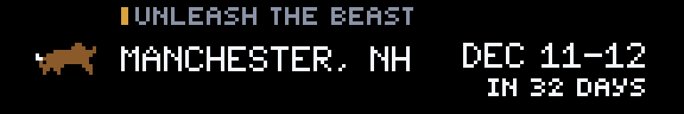
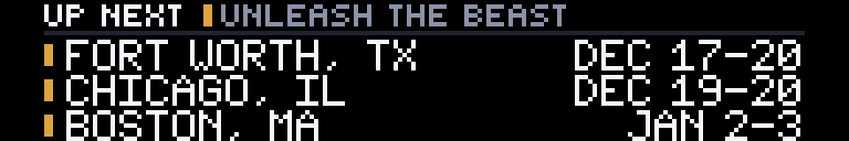
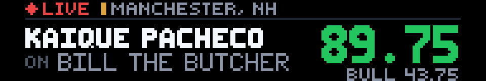
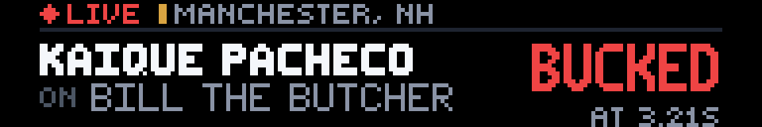
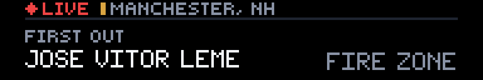
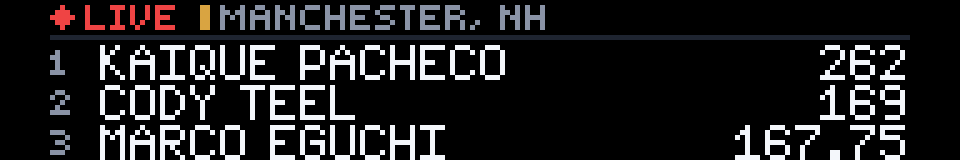
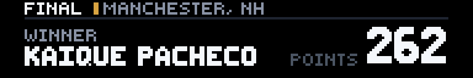
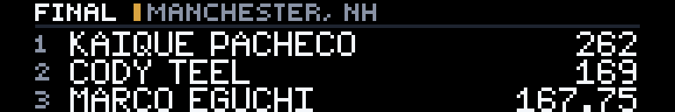

# PBR Bull Riding

**Created by Reyos** · Sports · 192×32 SCROLL · No API key needed

Professional Bull Riders on your Glance panel: a countdown to the next event, **every ride live** with the rider's and the bull's score, and the event leaderboard. The app switches modes by itself as the weekend goes from *countdown* to *live* to *final*.


> 💬 **Comments or suggestions?** Reach out to **Reyos** on Discord.

---

## Contents

- [At a glance](#at-a-glance)
- [Before an event](#before-an-event)
- [During an event](#during-an-event)
- [After an event](#after-an-event)
- [Settings](#settings)
- [Bull riding in 30 seconds](#bull-riding-in-30-seconds)
- [How it works](#how-it-works)
- [Screens for every situation](#screens-for-every-situation)
- [Limitations](#limitations)
- [For developers](#for-developers)

---

## At a glance

The app has two pages that change with what's happening:

| | **Page 1: event** | **Page 2: board** |
|---|---|---|
| **Before an event** | Countdown to the next stop | The next three stops |
| **During an event** | The latest ride, rider vs bull | Live leaderboard (top 3) |
| **After an event** | The winner and his points | Final top 3 |

A pixel-art **bucking bull** marks the app, so it stands out between the other apps in your scroll.

---

## Before an event

### Countdown



- **Tour:** gold for Unleash The Beast, teal for the Velocity Tour.
- **Host city:** the biggest text on the panel.
- **Dates:** for example `DEC 11-12`.
- **Countdown:** `IN 32 DAYS`, then `TOMORROW` and `TONIGHT 7:45 PM` in amber, using the arena's local time.

### Up next



The three stops after that, each with its dates and a tour-colored marker.

---

## During an event

The app goes live by itself when PBR marks the event live, usually within 2–4 minutes. A red **● LIVE** tag and the host city run across the top.

### The latest ride



When a rider makes the 8 seconds:
- **Rider:** his full name, or his last name if it's too long.
- **Bull:** shown under the rider as `ON BILL THE BUTCHER`.
- **Score:** the rider's score in big **green** numbers, with the bull's score underneath.



When the bull wins, **BUCKED** shows in **red**, with how long the rider lasted (`AT 3.21S`).

### Before the first ride



When PBR has posted the draw (which rider gets which bull), the app shows who's **first out** and on which bull. Before the draw is posted, it shows `CHUTES OPEN SOON`.

### Live leaderboard



The top three riders in the event and their running totals.

---

## After an event



A **FINAL** card with the event winner and his total points.



The final top three. Once PBR closes out the weekend, the panel moves on to the countdown for the next stop.

---

## Settings

There's one setting, so setup takes seconds.

| Setting | Options | What it does |
|---|---|---|
| **Tour** | **Unleash The Beast** *(default)* | PBR's top tour: the world's top 40 riders and the biggest events, including PBR special events. |
| | **Velocity Tour** | The tour below Unleash The Beast. It has the most stops and lots of up-and-coming riders. |
| | **All Tours** | Every PBR event in the US, including the Touring Pro Division. It also picks up any other series PBR adds to its schedule, such as the PBR Teams season. |

---

## Bull riding in 30 seconds

New to the sport? Here's all you need to read the panel:

- 🐂 **8 seconds:** a rider has to stay on for 8 seconds, holding the rope with one hand, to get a score.
- 💯 **Out of 100:** a qualified ride is scored out of 100. Up to **50 points are for the rider** and up to **50 for the bull**, because a tougher bull earns a bigger score. **90+ is a big ride.**
- ❌ **Buck-off:** if the rider comes off early, he gets no score (the bull is still scored). The panel shows `BUCKED` and the time he lasted.
- 🏆 **Event totals:** a rider's scores add up across the rounds, so the leaderboard numbers are bigger than a single ride.

---

## How it works

**Data:** PBR's own public event data, the same feed pbr.com's live ticker uses. No account or API key is needed.

**Which event it shows:**
1. An event that's **live** right now, if there is one.
2. Otherwise, an event that **just finished**.
3. Otherwise, the **next upcoming** event on your tour.

**Timing:**
- **Panel refresh:** every **2 minutes**, so live rides show up within a couple of minutes.
- **Schedule check:** the schedule is re-checked every 2 minutes, so the app notices when an event goes live.
- **Live details:** the latest ride and the leaderboard are fetched only during an event, at most once a minute.
- **Load on PBR:** each refresh makes at most **two** requests to PBR.

**Names:**
- **Bulls:** the feed puts the owner or sponsor in front of the bull's name ("Marquis Metal Works Bill The Butcher"). The app keeps the bull's own name ("**BILL THE BUTCHER**").
- **Riders:** rider names are never cut off mid-word. A long name falls back to the rider's last name.

**Colors:**

| Color | Meaning |
|---|---|
| 🟢 Green | A qualified 8-second ride |
| 🔴 Red | A buck-off, and the LIVE tag |
| 🟠 Amber | The event is tonight or tomorrow |
| 🟡 Gold | Unleash The Beast |
| 🔵 Teal | Velocity Tour |

---

## Screens for every situation

The app never shows a blank or broken panel:

| Situation | What you see |
|---|---|
| PBR's site can't be reached | `PBR FEED OFFLINE` · `SCORES RETURN WHEN PBR.COM IS BACK` |
| No events on your tour | `OFF SEASON` · `NEXT SCHEDULE NOT POSTED YET` |
| Live, but no rides yet | `FIRST OUT` with the draw, or `CHUTES OPEN SOON` |
| Live, no leaderboard yet | `LEADERBOARD AFTER THE FIRST RIDES` |
| Finished, results not posted yet | `RESULTS COMING SOON` |
| No more events announced | `NO MORE EVENTS POSTED YET` |

---

## Limitations

- **Data source:** this is PBR's public website data, not an official API. If PBR changes it, the app shows its offline screen instead of crashing.
- **World standings:** the season title race isn't shown, because PBR only publishes standings as a web page, not in its data feed.
- **Countdown timing:** the countdown uses each arena's standard time zone. In summer it can switch to `TONIGHT` an hour early or late around midnight.

---

## For developers

| | |
|---|---|
| **Size** | 192×32 (SCROLL) |
| **Pages** | `event`, `board` |
| **Refresh** | 120 seconds. The only setting is a dropdown, as Glance requires for refreshes under 5 minutes. |
| **Requests** | 1–2 per render, both to `pbr.com` |

**Feeds used:**
- `https://www.pbr.com/umbraco/api/eventlite/getupcomingeventlist`: upcoming events with tour, dates, city, time zone and a status (before / `LivePre` / `Live` / `LivePost` / `PostEvent`). Cached 120 s.
- `https://www.pbr.com/umbraco/api/eventlite/geteventinfo?id=<event>`: the leaderboard (`Results`), latest ride (`Tracker`) and draw (`Draw`). Only fetched while an event is live or just finished. Cached 60 s.

**Preview and check it locally:**

```powershell
gdn studio apps/pbr-bull-riding
gdn render apps/pbr-bull-riding --page 1
gdn render apps/pbr-bull-riding --page 2 --input "tour=VELOCITY TOUR"
gdn validate apps/pbr-bull-riding
```

---

**Created by Reyos** · Comments or suggestions? Reach out to **Reyos** on Discord.

Built for the [Glance Developer Network](https://github.com/glance-led-dev/glance-dev-network).
