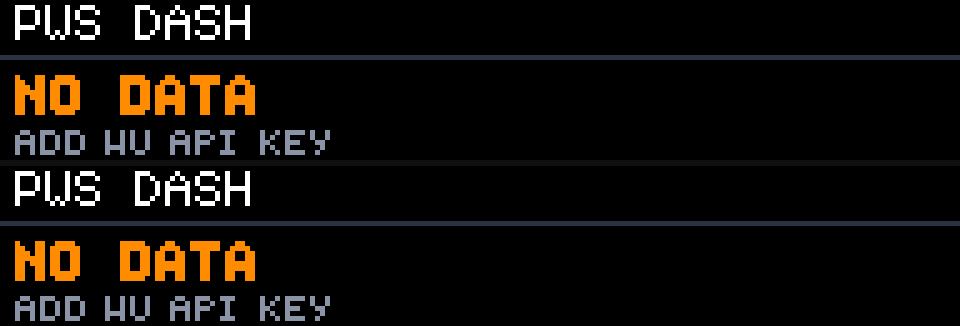

# PWS Dashboard

Live readings from your own Weather Underground personal weather station, with
National Weather Service alerts for the same point on the map.



A 192x32 SCROLL app by reyos86. Everything on the board comes from your
station and your key — no shared feed, no third-party scrape.

## Requirements

A **Weather Underground PWS contributor key**, free from
[wunderground.com/member/api-keys](https://www.wunderground.com/member/api-keys).
You have to be contributing data from a station to get one. Without a key the
board shows `NO DATA / ADD WU API KEY` rather than sample numbers — this app
has no demo mode by design, because a weather board showing invented weather
is worse than one that says it has nothing.

## Settings

| Setting | What it does |
|---|---|
| **Weather Underground API key** | Required. See above. |
| **Station ID** | Your PWS ID, e.g. `KTXDALLAS123`. It's on your WU station page. |
| **Station name** | The header label. Uppercase suits the bitmap fonts. Long names are fitted to the space left by the update stamp, not cut at a fixed length. |
| **Units** | `e` for imperial (°F, inHg, mph), `m` for metric (°C, mb, km/h). |

## The two pages

**station** — condition icon, temperature with trend, wind, the comfort
reading, pressure and humidity gauges with trends, and dew point.

**alerts** — active NWS alerts for the station's coordinates, ordered
WARNING → ADVISORY → WATCH → other. Two titles fit on screen out of up to
three fetched. Nothing active reads `ALL CLEAR`.

## The comfort reading

The bottom-left figure is not always the same quantity, so it does not always
carry the same name:

| Shown | When | Colour |
|---|---|---|
| `WIND CHILL 12` | wind chill is more than half a degree below air temperature | light blue |
| `HEAT INDEX 103` | heat index is more than half a degree above it | orange |
| `FEELS LIKE 41` | neither applies — the air temperature stands on its own | light blue |

WU only fills `heatIndex` above roughly 80°F and `windChill` below roughly
50°F, returning the dry temperature otherwise, so the two are never both true
at once. The word and the colour come from a single table in `app.star`
(`FEEL_BANDS`) so they cannot drift apart — an orange `WIND CHILL` would be
the board contradicting itself.

The phrase is measured before it is drawn and falls back to a short form
(`CHILL`, `HEAT`, `FEEL`) if a reading ever runs long.

## Display behaviour

- **Temperature** — integer with a degree mark, and a trend chevron against
  roughly the last hour of station history.
- **Wind** — eight-point cardinal plus integer speed (`SW13`). At three
  digits the cardinal is dropped and the number takes the column: `123` is
  the news, and `NW123` does not fit in the 23 px available.
- **Pressure / humidity** — arc gauges with numeric readouts and trends,
  when history or the WU pressure trend is available.
- **Condition icon** — from the TWC icon code, cross-checked against
  Open-Meteo, with rain or snow forced whenever the station's own gauge
  reports precipitation. The station's rain gauge is more local than a
  gridded forecast icon, so it wins.
- **Night art** — clear-sky art does not switch to the moon before 9 PM
  station-local, even when the vendor marks the period as night earlier.
- **Observation time** — the station's own local timestamp where present,
  otherwise panel time.

Icons are procedural bitmaps in `app.star`; no image assets ship with the app.

## Data sources

| Source | Used for |
|---|---|
| `api.weather.com` PWS current | The live observation |
| `api.weather.com` PWS 1-day history | Temperature, pressure and humidity trends |
| The Weather Company currents | Condition icon code for the station's coordinates |
| Open-Meteo | Weather-code cross-check for modelled sky conditions |
| `api.weather.gov` | Active alerts for the station's latitude/longitude |

Five calls at most per render, each cached for 300 seconds.

## Error states

Each failure is named separately, so the screen says what to do about it:

| Screen | Meaning |
|---|---|
| `NO DATA` / `ADD WU API KEY` | No key set |
| `NO STATION` | No station ID set |
| `BAD API KEY` | WU rejected the key (401/403) |
| `BAD STATION` | Station ID not found (404) |
| `RATE LIMITED` | WU returned 429 |
| `WU ERROR` | Any other HTTP status |
| `DATA EXPIRED` / `STATION OFFLINE` | WU answered with an errors object |
| `NO OBS` | No recent reading |
| `NO LOCATION` | The station reports no latitude/longitude |

Both pages share the observation fetch, so a station failure takes both down
together.

## Running it

From the repository root:

```bash
gdn studio apps/pws-station
```

Rendering a page with your own station:

```bash
gdn render apps/pws-station --input "station=KTXDALLAS123" --input "apikey=YOUR_KEY" --page 1
```

If `gdn` is not on `PATH`, use `python -m gdn.cli` in its place.

## Known limitations

- A contributor key is required; there is no keyless or demo path.
- Sky conditions come from location weather services plus the station's
  precipitation override, not from any camera or sky sensor on the station.
- The alerts page shows two titles even when the header count is higher.
- `refresh` is 1800s while the fetches cache for 300s. The panel only draws
  on refresh, so this costs nothing in practice, but the two are not in step.
- Pages are still images redrawn on the refresh timer.

Built for the [GLANCE Developer Network](https://github.com/glance-led-dev/glance-dev-network).
