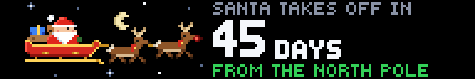
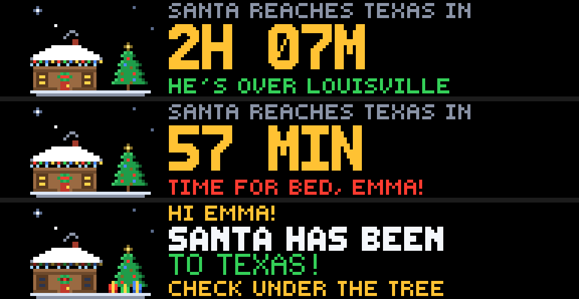
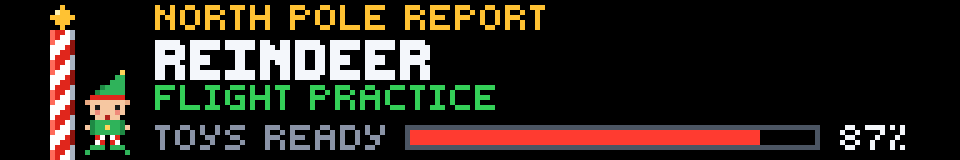
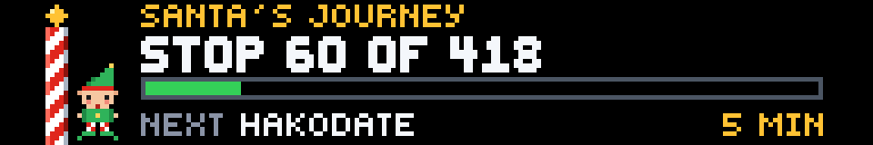
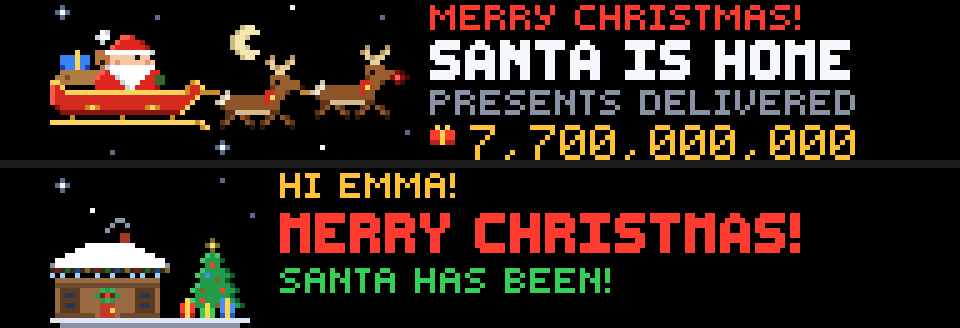

# Santa Tracker

**Created by Reyos** · Lifestyle · 192×32 SCROLL · No API key needed

Santa's sleigh on your Glance panel, made for kids. All year it counts down to takeoff with a daily report from the North Pole. On **Christmas Eve** it follows Santa **live, city by city**, counts the presents he's delivered and tells your kids **how long until he reaches where they live**. And when it's close: *"TIME FOR BED, EMMA!"*


> 💬 **Comments or suggestions?** Reach out to **Reyos** on Discord.

---

## Contents

- [At a glance](#at-a-glance)
- [Page 1: The sleigh](#page-1-the-sleigh)
- [Page 2: Your house](#page-2-your-house)
- [Page 3: The North Pole](#page-3-the-north-pole)
- [Christmas morning](#christmas-morning)
- [Settings](#settings)
- [The pixel art](#the-pixel-art)
- [How it works](#how-it-works)
- [Screens for every situation](#screens-for-every-situation)
- [Limitations](#limitations)
- [For developers](#for-developers)

---

## At a glance

The app follows the calendar through three seasons:

| | Before Christmas Eve | Christmas Eve (live) | After Christmas |
|---|---|---|---|
| **1 · sleigh** | Days (then hours) until Santa takes off | **Where Santa is right now** and the presents delivered | Santa's home; the final present count |
| **2 · home** | **Sleeps till Christmas**, with your kids' names | **Countdown to Santa reaching where you live** | *Merry Christmas!* Presents under the tree |
| **3 · northpole** | The elves' report and the toy workshop meter | **Santa's journey**: stop number, progress bar, next stop | The elves are asleep |

---

## Page 1: The sleigh


**On Christmas Eve:** Santa, his sleigh and his reindeer team (Rudolph leading, nose glowing) fly under the moon.

- **Header:** a red **● LIVE** tag and where Santa is: **`SANTA IS IN`** while he's at a stop, **`FLYING TO`** on the way to the next one.
- **City:** the city in big letters, with the state or country underneath (`LOUISVILLE` · `KENTUCKY, USA`).
- **Presents:** the running total, climbing between stops (`7,124,789,328`).



**Before Christmas Eve:** *SANTA TAKES OFF IN* **45 DAYS** *from the North Pole*. On Christmas Eve morning it switches to hours and minutes (`2H 00M`).

---

## Page 2: Your house


A snowy log cabin with string lights, lit windows, a wreath on the door and smoke from the chimney, beside a decorated tree.

**Before Christmas:** **`HI EMMA!`**, then the big number every kid asks about: **46 SLEEPS** till Christmas. Sleeps are counted in your own time zone, so they tick over at your midnight. On Christmas Eve it reads **`TONIGHT'S THE NIGHT!`**



**On Christmas Eve**, the page counts down to Santa reaching **where you live**:

1. **Counting down:** *SANTA REACHES TEXAS IN* **2H 07M**, with where he is right now (`HE'S OVER LOUISVILLE`).
2. **Under an hour away:** **`TIME FOR BED, EMMA!`** in red.
3. **He's been:** **`SANTA HAS BEEN TO TEXAS!`** The windows go dark (everyone's asleep), presents appear under the tree, and it says *CHECK UNDER THE TREE*.

---

## Page 3: The North Pole



An elf stands beside the candy-cane North Pole.

**Before Christmas:** the **North Pole report**, with a new line every hour:

- *Rudolph's nose: fully charged*
- *Nice list: checked twice*
- *Mrs. Claus: baking cookies*
- *The reindeer: eating carrots*
- …and more.

Underneath, the **TOYS READY** meter fills up through the year, from 0% after Christmas to 99% on Christmas Eve.



**On Christmas Eve:**

- **Santa's journey:** **`STOP 60 OF 418`**, with a progress bar for the whole trip.
- **Next stop:** the next city and how many minutes until he gets there (`NEXT HAKODATE` · `5 MIN`).

---

## Christmas morning



From Christmas Day until January 5:

- **Page 1:** *SANTA IS HOME*, with the final count of **7,700,000,000 presents delivered**.
- **Page 2:** **MERRY CHRISTMAS!** with presents under the tree.
- **Page 3:** the elves are asleep (*ZZZ… see you next Christmas*).

On January 6 the countdown to next Christmas begins.

---

## Settings

| Setting | Options | What it does |
|---|---|---|
| **Kids' names** | Free text, or **NONE** *(default)* | Personalizes the house page: `HI EMMA!`, `TIME FOR BED, EMMA AND JACK!` With NONE it says `HO HO HO!` |
| **Where you live** | **NONE** *(default)*, any **US state** (and DC), or any **Canadian province or territory** | On Christmas Eve, the house page counts down to Santa reaching your state, and the sleeps count uses its time zone. With NONE, it counts down to Santa reaching North America (Eastern time for sleeps). |

**How "where you live" works:** each state is matched to the nearest stop on Santa's route to its largest city. For example, Texas → Dallas, Florida → Orlando, New Jersey → New York, Kansas → Tulsa. The countdown is to the moment Santa reaches that stop, which is around midnight local time.

---

## The pixel art

Every sprite is shaded in three tones (highlight, base and shadow), and the lights glow:

- **Santa:** red suit with a fur-trimmed hat and pompom, rosy cheeks, a white beard and a gold belt buckle.
- **The sleigh:** glossy red with gold trim, a curled front and gold runners. The sack holds a wrapped present and **a teddy bear peeking out**.
- **The reindeer:** shaded coats, two-tone antlers, red collars with gold bells, and **Rudolph** in front with a glowing nose.
- **The night sky:** a crescent moon and twinkling stars.
- **The house:** a snow-covered log cabin with **colored string lights**, icicles, warm windows, a wreath, and chimney smoke.
- **The tree:** a star on top and colored ornaments.
- **The North Pole:** a shaded candy-cane pole with a gold ball, and an elf with pointy ears and curly shoes.

Glance frames are still pictures. On each refresh, the reindeer switch between two gallop poses and different stars twinkle, so the panel changes through the night. Every frame is a complete picture on its own.

---

## How it works

**Data:** the route from [Google's Santa Tracker](https://github.com/google/santa-tracker-web) (open source): **418 stops** around the world, each with its arrival and departure time, city, region and running present count. It's free and needs no account or API key.

**Timing:** the route is timed for one Christmas Eve, so the app moves every stop onto this year's: takeoff **December 24 at 10:00 UTC** (5 AM Eastern), back at the North Pole **December 25 at 11:00 UTC**. Santa reaches US cities around local midnight.

**Requests:** none at all before Christmas Eve; the countdown, sleeps and North Pole report are all calculated on the panel. While Santa is flying, one request (the route, about 730 KB, cached for 6 hours).

**Refresh:** every **5 minutes**. Glance requires that for an app with a free-text setting (the kids' names). Santa makes a stop every few minutes, so the city changes on most refreshes.

---

## Screens for every situation

| Situation | What you see |
|---|---|
| Route can't be loaded on Christmas Eve | Page 1: `SANTA IS FLYING!` · `DELIVERING PRESENTS AROUND THE WORLD`; page 2: `SANTA IS COMING!`; page 3: `ON HIS WAY!` |
| No names set | `HO HO HO!` instead of `HI …!` |
| No area set | Counts down to Santa reaching North America |
| Christmas Day morning | `MERRY CHRISTMAS!` everywhere |

---

## Limitations

- **Not NORAD:** the route is Google's Santa Tracker route; this app isn't affiliated with NORAD or Google.
- **States, not streets:** "where you live" is your state or province, matched to Santa's nearest stop.
- **US and Canada:** the area setting covers the US and Canada. Families elsewhere can still follow Santa live on pages 1 and 3.
- **Snapshots:** the panel refreshes every 5 minutes, so it shows most stops but not every one.

---

## For developers

| | |
|---|---|
| **Size** | 192×32 (SCROLL) |
| **Pages** | `sleigh`, `home`, `northpole` |
| **Refresh** | 300 seconds (free-text input) |
| **Requests** | 0 per page outside Christmas Eve; 1 (cached 6 h) while Santa flies |

**Endpoint:** `GET https://firebasestorage.googleapis.com/v0/b/santa-tracker-firebase.appspot.com/o/route%2Fsanta_en.json?alt=media` → `destinations[]` with `id`, `arrival` / `departure` (ms), `city`, `region`, `presentsDelivered` and `location`. The first stop is `takeoff` and the last is `landing` (both at Santa's Village). Times are shifted by `takeoff(this year) − destinations[0].departure`.

**City names** come in their own spelling (`Nukuʻalofa`, `São Paulo`, `İstanbul`). Accents are folded to A–Z for the panel fonts.

**Preview any moment of the year:**

```powershell
gdn studio apps/santa-tracker
gdn render apps/santa-tracker --page 1 --now 2026-12-25T05:30 --input "home=TEXAS"
gdn render apps/santa-tracker --page 2 --now 2026-12-25T06:40 --input "names=EMMA" --input "home=TEXAS"
gdn validate apps/santa-tracker
```

---

**Created by Reyos** · Comments or suggestions? Reach out to **Reyos** on Discord.

Built for the [Glance Developer Network](https://github.com/glance-led-dev/glance-dev-network).
