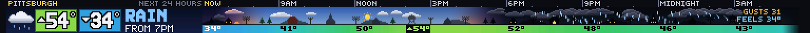
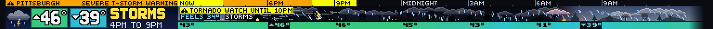
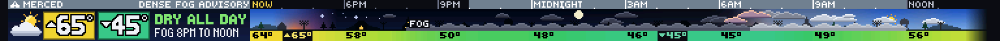
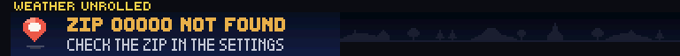

# Weather Unrolled

Created by scottkle · Weather · 192×32 SCROLL · No API key needed

The next 24 hours drawn as one moving scene. The Scroll's own motion is the timeline: later hours arrive from the right, so watching the display is like watching the day pass.

## What it shows

**The opening card.** A quick answer to "what is today like?" It shows the town, a weather picture, the high and low on colored tiles, and a short headline such as RAIN FROM 7PM, SNOW 5" BY 8AM or DRY ALL DAY. When the Weather Service has an active alert, the top strip turns the alert's official color and names it.

**The 24-hour scene.** Three joined pages start at the current hour:

- The sky moves from night to dawn to day and back, with the real sunrise, sunset and moon (in tonight's phase).
- Clouds thicken with cloud cover. Rain and snow appear only when the chance is real.
- A small town skyline sits along the bottom. It follows the seasons and collects snow during a snowfall.
- A temperature band runs underneath. Its colors are fixed, so a given color always means the same temperature, from deep blue in the cold to red in the heat.
- A few short labels mark what matters most: the high and low, feels-like temperature, gusts, fog, snow and ice totals, and alerts.

## How to read it

| You see | It means |
| --- | --- |
| No rain or snow drawn | Less than a 40% chance |
| Light, scattered rain or snow | A 40% to 69% chance |
| Heavy, steady rain or snow | A 70% chance or higher |
| Pink rain or ice pellets | Freezing rain, sleet or a wintry mix, anything slippery |
| Slanted rain and white streaks | Wind: rain tilts from 25 mph, streaks appear with gusts of 30 mph or more |
| Dark clouds with lightning bolts | Thunderstorms possible |
| Gray haze along the ground | Fog |
| ▲ and ▼ tags on the band | The day's high and low, at the hour they happen |
| FEELS 18° | The wind chill or heat index differs noticeably from the air temperature |
| 5" BY 8AM | Expected snow (or ice) total by that time |
| Colored strip above the hours | A Weather Service warning, watch or advisory, in its official map color, over the hours it covers |

Leaves, bare branches and snow on the ground follow the season for your location, so a winter scene in Phoenix stays green while Minneapolis is white.

## Sample scenes

These two use made-up weather on a real town, to show what storms look like:

A real forecast with a dense fog advisory in Merced, California:

## Settings

- **ZIP code.** A 5-digit U.S. ZIP code. ZIP+4 also works.
- **Units.** Fahrenheit or Celsius. In Celsius, gusts show in kilometers per hour.
- **Town name (optional).** Replaces the town name that comes with the ZIP code, for example to show a neighborhood. Long names are hidden rather than cut off.

## When something is wrong

Instead of a blank or broken display, the app shows a clear card with what to do, and a quiet night skyline on the other pages.

- NO ZIP CODE YET, ZIP SHOULD BE 5 NUMBERS or ZIP NOT FOUND: check the ZIP code in the settings.
- NO FORECAST FOR THIS ZIP: the Weather Service has no forecast grid there. Try a nearby ZIP code.
- WEATHER SERVICE IS DOWN, TOWN LOOKUP IS DOWN or FORECAST RUNNING LATE: nothing to fix. The app tries again on its own.
- If the newest forecast is more than 6 hours old, the card says FORECAST FROM and the time, so you know the picture may be stale.

## Limits

- United States only. All data comes from the National Weather Service. Some territories, such as Guam, are not found by the ZIP lookup.
- The scene covers 24 hours, but the last half hour fades into the edge of the display.
- Chances, totals and alert times are the Weather Service's forecast, refreshed about every 20 minutes. They can change.

## Data sources

- Forecast and alerts: [National Weather Service API](https://www.weather.gov/documentation/services-web-api) (api.weather.gov)
- ZIP code to location: [Zippopotam.us](https://zippopotam.us)
- Sunrise, sunset and moon phase are calculated in the app.
