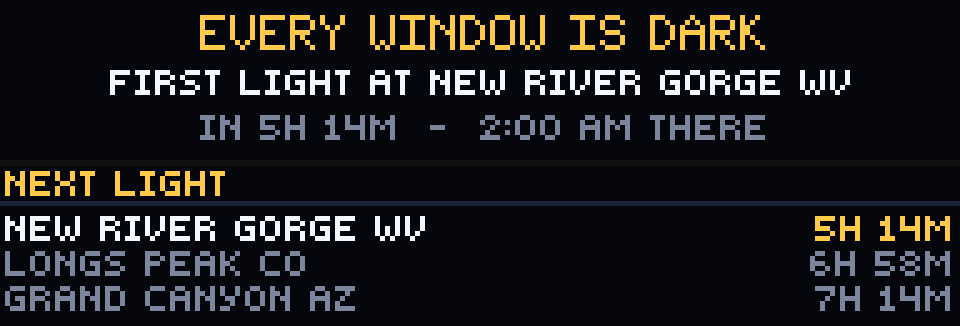

# Window

A window onto a national park, live, on a **192x32** panel. Eight public
webcams, and the panel shows whichever one the sun is highest over at this
minute — first light over the New River Gorge, mid-morning on the rim of the
Grand Canyon, the last of the day on Kīlauea.



No key, no account. Every camera is a US federal feed in the public domain.

## Why it follows the sun

A webcam panel sounds simple until you look at one at two in the morning.
I checked all twenty cameras I could find at 06:45 UTC: every single one was
black, fogged in, or showing infrared mush. Pointing the panel at one
favourite camera gets you something lovely for half the day and a dark
rectangle for the other half.

So the app ranks the cameras by the sun's altitude over each one and shows
the brightest. That costs nothing — solar position is arithmetic, not an API
call — and it means the panel is lit from about 12:15 UTC, when the sun
clears the ridge in West Virginia, until about 04:00 UTC, when it leaves
Kīlauea.

The gap is real and the app does not pretend otherwise. For roughly eight
hours a night there is genuinely nothing in the United States to look at, so
those hours get a card naming the next window to catch the light and how
long until it does, and a board of the three closest behind it. Both are
drawn from arithmetic alone, so they work even with the network down.

## The eight windows

| Window | Where | Local zone |
|---|---|---|
| **New River Gorge** | West Virginia | Eastern |
| **Yellowstone** | Mammoth Hot Springs, Wyoming | Mountain |
| **Longs Peak** | Rocky Mountain NP, Colorado | Mountain |
| **Grand Canyon** | Arizona | Mountain, no DST |
| **Lake McDonald** | Glacier NP, Montana | Mountain |
| **Crater Lake** | Sinnott Overlook, Oregon | Pacific |
| **Mount Rainier** | Washington | Pacific |
| **Kīlauea** | Hawaiʻi | Hawaiʻi, no DST |

The time on the picture is the local time **at the camera**, not yours.
Arizona and Hawaiʻi do not keep daylight saving and the app knows it.

## Not every camera tells the truth

Two cameras I tried — Zion and Isle Royale — serve a bright, sunlit frame
all night long. The feed has stopped and the last good picture is still
sitting there; fetch it twice fifteen minutes apart and you get byte-for-byte
the same image. Both are left out of the set.

But that can happen to any camera at any time, and `http.get` hands back no
`Last-Modified` to check against. So every frame is weighed against where
the sun actually is:

- the sun is well up and the frame is nearly black → the camera is down,
- the sun is well past dusk and the frame is sunlit → the frame is stale.

Either way the app moves to the next camera rather than pass it off as live.
If you have pinned a camera and its frame fails that test, you get
`NOT LIVE` rather than a pretty lie.

## Settings

| Setting | What it does |
|---|---|
| **Which window** | `FOLLOW THE SUN`, or pin one park and stay there, dark or not. |
| **Clock** | 12 or 24 hour, for the time shown on the picture. |

With a park pinned, the first page stays there and the second page still
shows the best-lit of the others, so you keep one foot in the daylight.

## How a photograph gets onto a panel

`http.get` carries text, not bytes, and `c.image()` only reads files shipped
inside the app — so an image from the internet has no obvious way in. The
way through is [images.weserv.nl](https://images.weserv.nl), which fetches
any public image, crops and resizes it, and re-encodes it as a PNG with
**stored** (uncompressed) deflate blocks returned as base64. With `l=0`
there is nothing to inflate, so the decoder here is forty lines rather than
a zlib implementation. The technique is cfdmb's — [`rain-watch`](../rain-watch)
reads weather radar the same way.

## Where to cut the band

A 16:9 camera cropped to 6:1 keeps under a third of the frame, so *which*
third decides whether the panel is a photograph or a stripe of empty sky. I
compared the options on a daylight frame: a band through the middle of Zion
is a wall-worthy picture, while fitting the whole frame inside 192x32 gives
a 43-pixel postage stamp adrift in black.

weserv applies a manual crop *after* resizing, which would merely clamp a
192-pixel-wide image, but `fit=cover` with `a=crop-50-NN` crops about a
focal point *before* the resize. Every camera carries its own `NN`, set by
eye: 32% at the New River Gorge, where the ridge sits high in frame, down to
56% at Kīlauea, where the horizon is low. Cropping high also keeps the
caption bars that several NPS cameras burn into the bottom of the frame off
the panel.

## Drawing it

192x32 is 6144 pixels, while a page may emit at most 4096 draw ops and no
single bitmap may hold more than 4096 cells. `c.sprite` emits one bitmap per
colour in its legend, so the frame is quantised to at most 80 colours and
laid down in three 64-wide chunks.

The quantiser runs in Starlark, which rules out a nearest-colour search. The
buckets are fixed arithmetic — 32 steps of grey for anything near-neutral,
48 coarse chroma cells for everything else — while each bucket's colour is
the mean of the pixels that landed in it. Fixed buckets, adaptive palette,
one pass. The `overhead` app uses the same quantiser.

## Data sources

| Source | Cached |
|---|---|
| `nps.gov/webcams-*` — seven National Park Service cameras | 240s |
| `volcanoes.usgs.gov` — Kīlauea, from the Hawaiian Volcano Observatory | 240s |

`refresh` is 300s. One page makes one call when the first camera answers
with a believable frame, and at most three if it does not. The night pages
make none at all.

## When something is missing

| Screen | Meaning |
|---|---|
| `EVERY WINDOW IS DARK` | the sun is below the horizon at all eight, with the next sunrise named |
| `NEXT LIGHT` | the three windows closest to catching the sun |
| `NO PICTURE` | the camera did not answer |
| `NOT LIVE` | a pinned camera's frame does not match where the sun is |

No demo mode. A window that invents a view is not a window.

## Running it

From the repository root:

```bash
gdn studio apps/window
```

Rendering one page:

```bash
gdn render apps/window --page 1 --input "place=GRAND CANYON"
```

To see the no-data screens, set `GDN_HTTP_OFFLINE=1` first.

If `gdn` is not on `PATH`, use `python -m gdn` in its place.

**A note on the preview images.** They were made at 02:00 Eastern, when the
honest answer was that every window was dark, so they show the night pages.
Re-render them in daylight — any time between about 07:30 Eastern and
18:00 Hawaiʻi time — and they will show a sunlit park instead:

```bash
gdn render apps/window --page 1 --out apps/window/preview/view.png
```

Webcam imagery courtesy of the National Park Service and the U.S. Geological
Survey.

Built for the [GLANCE Developer Network](https://github.com/glance-led-dev/glance-dev-network).
